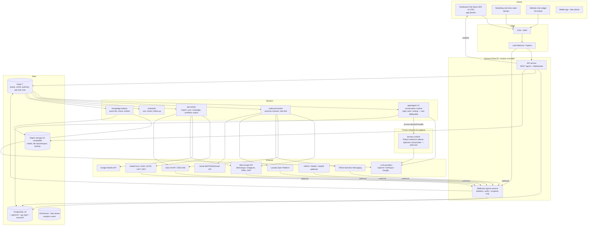

# 04 — System Architecture

> Status: **Proposal v1 — to be finalized** at the technical kickoff. Key decisions are recorded as ADRs in [`adr/`](adr/).
> References: `preny/preny-research/03-kien-truc-cong-nghe/*`, `08-dashboard-thuc-te/11-so-do-dashboard.md`.

## 1. What we know about Preny and how we handle it

| Preny (observed / published) | What we do |
|---|---|
| Website + dashboard on Next.js App Router, next-intl, Axios | **Do not copy.** Dashboard as a Vite + React SPA on a CDN (instant navigation), marketing site on Astro (ADR-009) |
| Separate backend `api.<domain>/api/v1`, header `X-ACCOUNT-ID`, bearer + refresh token | Similar: separate, versioned API, header `X-Workspace-Id`, access/refresh token — but **the server always checks membership** and never trusts the header |
| MongoDB (per their privacy policy) | **Do not copy.** Use PostgreSQL because the credit ledger, orders, and CRM need transactions + relational constraints (see [ADR-002](adr/ADR-002-postgresql.md)) |
| "ChatGPT platform", model labels Smart/Pro/Neo, Neo "coordinates multiple models" | Multi-provider LLM Gateway; Smart/Pro/Neo are **commercial tiers** mapped to pipeline configurations (see [06](06-ai-engine.md)) |
| Queue, vector DB, cloud unknown | Our own design: Redis + BullMQ, pgvector, S3-compatible object storage |

## 2. Architecture principles

1. **Modular monolith first, split into services when there is data to justify it.** One backend codebase divided into modules by domain with clear boundaries (no cross-importing another module's repository — only via service interfaces or domain events). Only 2 things with a very different load profile are split out from day one: **webhook ingress** and **workers**.
2. **Separate 3 load domains** (exactly as analyzed in the Preny dossier): Administration (CRUD, low volume, must have correct permissions) / Conversation processing (latency-sensitive, bursty) / Background tasks (import, campaigns, sync, reconciliation — must never slow down new messages).
3. **Everything goes through idempotent queues.** Webhook received → write `inbound_event` (unique on `channel + external_event_id`) → ack 200 immediately → process async.
4. **Multi-tenant from day 1.** Every business table has `workspace_id`; Postgres Row-Level Security acts as a second line of defense.
5. **Immutable ledger for money/credit/quota.** Never `UPDATE balance = balance - x` without a matching ledger row in the same transaction.
6. **Every AI answer is observable**: trace from message → retrieved knowledge → model/version → prompt version → output → cost.
7. **Versioned configuration**: bot config + knowledge are versioned; every AI message records `bot_version_id`.

## 3. Overall diagram



## 4. Proposed stack

| Layer | Choice | Rationale | Alternative |
|---|---|---|---|
| Language | **TypeScript** throughout (frontend, backend, worker, widget) | One full-stack team, types/DTOs shared via a common package | Go backend if the team is strong in Go |
| Monorepo | **pnpm workspaces + Turborepo** | Build cache, `shared` package | Nx |
| Dashboard | **Vite + React 19 SPA**: TanStack Router (preloading), TanStack Query, TanStack Table + Virtual, **Tailwind v4 + shadcn/ui**, `motion`, `cmdk`, React Hook Form + Zod, i18next; static files on CDN (ADR-009) | Instant client-side navigation, optimistic UI, heavy data tables (CRM/orders); no SEO needed; cheapest layer to scale | Next.js App Router (previous choice, superseded by ADR-009) |
| Marketing site | **Astro** (static, islands) + content collections; same design tokens | Fastest public pages for Vietnamese SEO, industry-specific content, blog, case studies (Preny has ~140 content URLs) | Next.js SSG + headless CMS |
| Backend API | **NestJS** (Fastify adapter), **Drizzle ORM**, Zod DTOs (`nestjs-zod`) | Modules + guards give agent-written code a fixed structure; Fastify for speed. Rules to limit framework magic: no request-scoped providers, no circular module imports (lint), thin handlers, framework-free domain services | Plain Fastify/Hono + explicit modules (considered; revisit if NestJS friction shows in T-003) |
| Inference sidecar (optional) | **`hermes-runtime`** (`services/hermes`, Python): private HTTP bridge reached only through `packages/ai-core`'s `HermesProvider`, selected per tier in the admin LLM config (ADR-010) | Reuse the existing Hermes agent core without porting it; platform logic stays in NestJS | A TypeScript provider (planned replacement; no module changes needed) |
| Webhook ingress | Thin **Fastify** app (no NestJS): verify → persist → enqueue | p95 ≤ 200 ms / p99 ≤ 500 ms ack; isolated from API deploys | — |
| Realtime | **SSE** (server→client: inbox updates, agent streaming) fed by Redis pub/sub, resumable via `Last-Event-ID`; a small websocket-only **Socket.IO** surface for typing/presence (Redis adapter, no sticky sessions); separate `realtime` deployment | Stateless scaling, survives deploys and Cloudflare idle cut-offs (heartbeat 30 s) | Ably / Cloudflare Durable Objects if connections outgrow a small Node tier |
| Queue | **BullMQ** on Redis + our own tenant-fairness layer (`packages/queue`: Redis token bucket per workspace/channel, tier queues) | Delayed jobs, retry/backoff, repeatable jobs. Per-group limits are BullMQ Pro only (ADR-003) | Trigger.dev / Temporal for durable multi-step workflows (decision gate at Beta); Kafka at > a few thousand msg/s |
| Database | **PostgreSQL 16** + pgvector + pg_trgm + unaccent; PgBouncer | Transactions for ledger/orders, JSONB for flexible data, vectors in the same DB reduce operations | Mongo (like Preny) – not recommended |
| Search | Postgres FTS + trigram (Vietnamese unaccent) in the early phase | Sufficient for CRM with a few hundred thousand records/tenant | OpenSearch / Meilisearch when needed |
| Object storage | **MinIO** (self-hosted, S3-compatible, erasure-coded, multi-node) | Bot media, import files, attachments, exports, backups; S3 API keeps the code portable | Any S3-compatible service if the hosting decision changes |
| Analytics | Postgres materialized views → **ClickHouse** at scale | Conversation/order/campaign statistics | — |
| LLM | Internal LLM Gateway (`ai-core` package) calling multiple providers; Vercel AI SDK or native SDKs | Switch models without changing business code, fallback, cost measurement | LiteLLM proxy |
| Embedding | A multilingual model with good Vietnamese support (candidates: OpenAI text-embedding-3-small/large, Gemini embedding, self-hosted bge-m3) | Chosen via a Vietnamese eval set, not by gut feeling | — |
| Auth | Built in-house (JWT access 15', refresh token rotation stored in DB, 2FA TOTP) + Google OAuth login | Need tight control over workspace/role | Keycloak / Clerk |
| Observability | OpenTelemetry → **self-hosted Grafana LGTM stack** (Loki logs, Mimir/Prometheus metrics, Tempo traces, Grafana dashboards/alerting); **Sentry self-hosted**; **Langfuse self-hosted** (v3: Postgres + ClickHouse + Redis + MinIO) for LLM traces | Owner constraint: no managed/cloud observability; all telemetry stays on our servers | Sampling of successful LLM traces if ClickHouse volume becomes a cost |
| Infrastructure | **Self-hosted**: Docker Compose on 2–3 VMs/bare-metal for MVP → **Kubernetes** (k3s/RKE2 or kubeadm) with Helm + Argo CD for production; Postgres via **Patroni** (HA) + **pgBackRest** (PITR); Redis Sentinel; MinIO | Owner constraint: no managed cloud services (no cloud Postgres/Grafana/Langfuse). See [10](10-operations-and-deployment.md) | — |
| CI/CD | GitHub Actions / GitLab CI, Terraform, Argo CD (once on K8s) | — | — |

> Note on Vietnamese data: if selling to large enterprises/state organizations, host the primary infrastructure in Vietnam (Viettel IDC, VNG Cloud, FPT Cloud…) and clearly document data flows abroad (LLM providers) in accordance with the personal data protection (BVDLCN) law. See [09](09-security-and-compliance.md).

## 5. Backend modules (bounded contexts)

| Module | Responsibility | Main tables (see [05](05-data-model.md)) |
|---|---|---|
| `identity` | Sign-up, login, email/phone OTP, 2FA, sessions, user profile | users, sessions, otp_codes |
| `workspace` | Workspaces, members, invitations, roles, permissions, customer distribution rules | workspaces, members, roles, assignment_rules |
| `billing` | Plans, entitlements, quotas, subscriptions, AI wallet, ZBS wallet, ledger, vouchers, payments, invoices | plans, subscriptions, wallets, ledger_entries, payments, vouchers, usage_counters |
| `bot` | Bots, basic/advanced configuration, reply schedule, versions, edit history | bots, bot_versions, bot_settings, bot_audit |
| `knowledge` | FAQ, documents, situation guides (scripts), bot products, media albums, quick replies, indexing | knowledge_items, knowledge_chunks, bot_products, media_albums, media_assets, quick_replies |
| `channel` | Channel connections (FB page, IG, Zalo OA, TikTok, Lazada, website widget), tokens, webhooks, status | channel_connections, channel_tokens, inbound_events |
| `conversation` | Conversations, messages, bot ON/OFF status, assignment, handoff, history sync | conversations, messages, conversation_assignments, handoffs |
| `webchat` | Website chat: public widget API (`/api/v1/webchat/v1/sites/{key}`: config, messages, uploads, phone), visitors, origin check, rate limits, visitor details for the inbox. Messages enter the same inbox queue as Facebook (`channel.enqueueWebsiteEvent`) | webchat_visitors |
| `ai` | Reply orchestrator, tool calling, guardrails, AI tagging, phone number (SĐT)/address extraction, metering | ai_runs, ai_tool_calls |
| `crm` | Customers, multi-channel identity, sources, statuses, tags, customer lists (segments), notes, tasks/reminders, files, timeline, CRM automation rules, import/export | contacts, contact_identities, sources, pipeline_statuses, tags, segments, notes, tasks, crm_rules |
| `commerce` | Operational catalog, variants, inventory, orders, fulfillment status, orders from chat, order settings, Google Sheet sync | products, product_variants, warehouses, inventory, orders, order_items, order_settings |
| `shipping` | Carrier connections, waybill creation, status webhooks, COD, reconciliation | carrier_accounts, shipments, shipment_events, cod_reconciliations |
| `marketing` | ZBS/ZNS campaigns, FMM, email, templates, audiences, Tool Ads (chat-opening JSON), CAPI | campaigns, campaign_recipients, message_templates, ad_entry_payloads, conversion_events |
| `automation` | Template-based workflows (silence chase-up, soft follow-up, after-sales, Zalo template), triggers, stop conditions, run log | workflows, workflow_runs, workflow_steps_log |
| `analytics` | Conversation, order, campaign, and AI usage statistics | rollup tables / ClickHouse |
| `notification` | In-app notifications, email, push, reminder milestones (0 min/2h/24h) | notifications, notification_prefs |
| `support` | Support tickets, attachments | tickets, ticket_messages |
| `affiliate` | Terms, referral links, referred customers, commissions, withdrawals, bank accounts | affiliate_accounts, referral_links, referrals, commissions, payouts |
| `admin` (back-office) | Internal administration: tenants, plans, bank-transfer payment approval, support, feature flags, audited impersonation | — |
| `audit` | Immutable activity log | audit_events |
| `assistant` | Owner assistant (ADR-023, T-170): an account owner's private chat threads with "Thỏ Rapiz", runs and their steps. Account-scoped (`withAccount`), not workspace-scoped | assistant_threads, assistant_messages, assistant_runs, assistant_run_steps, assistant_memory, assistant_proposals |

**Public widget surface (T-100).** `webchat` is the only module with unauthenticated routes beyond auth: `GET /webchat/v1/sites/{key}` (public look, never domains or bot id), `POST …/messages` (202, creates the visitor on the first message and returns its token), `GET …/messages?after=` (poll: messages, `botTyping`, `phoneCaptured`, `phoneRequired`), `POST …/uploads` (multipart field `file`, image only, 5 MB, public S3 URL), `POST …/phone` (501 until lead capture). Every call resolves the site by key and checks the browser `Origin` against the site's domains; anything else is a uniform `404 {error:"NOT_FOUND"}`. Replies use the small `{error: CODE}` body and CORS headers echoing the caller's origin (never `*`); an `onRequest` hook answers `OPTIONS` for this prefix only. Authed staff route: `GET /webchat/conversations/{conversationId}/visitor`. Tier 3 (flows): `webchat` uses the `channel`, `conversation` and `bot` facades only.

**Owner assistant API (T-170).** Thirty `@WorkspaceScoped()` routes, all `assistant: never` (`assistantRoutes`): `GET /assistant/threads` (`q` matches the title or a message, accent-insensitive; `archived=true|false`; ≤ 50, pinned first, then latest activity), `POST /assistant/threads` (201; freezes the system prompt `assistant@2` with the owner's name, the account's businesses, the platform skills index, the owner's memory snapshot and today's date; threads created before 1b keep `assistant@1`), `PATCH /assistant/threads/{threadId}` (title, pinned, archived), `GET /assistant/threads/{threadId}/messages` (user, assistant and event rows only; tool rows never leave the backend), `POST /assistant/threads/{threadId}/messages` (one chat turn, idempotent by `turnId`: the shared agent loop on the `pro` tier, at most 25 rounds and 90 s, with the tools `session_search`, `ui_navigate` (in-app `/app` paths only), `ui_spotlight` (targets on the current page only), `ui_fill_form` (drafts values into a form the page registered; never submits), `memory` (bounded stores `owner_profile` 1 400, `notes` 2 200 and `business:<id>` 1 000 chars, every write safety-scanned), the skills tools `skills_list` / `load_skill` / `skill_manage` (the owner's catalog: platform skills, an active shadow in place of the platform skill it copies, then the owner's active rows; `skill_manage` saves an owner skill only when the owner asks and patches only a skill loaded in the same turn), and the route tools `tool_search` / `tool_describe` / `tool_call` (below); a thread that grows past 80 active messages or 75 % of the context window is compacted first; at most 40 000 chars of tool output per turn; answers 200 with the turn's visible messages and its run, 409 `CONFLICT` with `details.reason = assistant_busy` while another run of the owner is running or `turn_id_taken` for a `turnId` that is not this thread's run, 503 `AI_UNAVAILABLE` when no model serves the tier; a model failure answers 200 with an apology and a `failed` run) `GET /assistant/runs/{runId}` (status and steps), `GET /assistant/memory` (every store of the owner with its label, limit and use; empty stores included), `DELETE /assistant/memory/{store}/entries/{entryId}` (forgets one entry, answers 200 with the remaining memory; 404 for an unknown store or entry), `GET /assistant/threads/{threadId}/proposals` (the thread's proposals, oldest first, stale pending ones expired first), and `POST /assistant/proposals/{proposalId}/approve` / `…/reject` (409 `CONFLICT` with `details.reason = proposal_not_pending` or `proposal_expired`; 404 for another owner's proposal or a business no longer in the owner's scope). Skills (1c): `GET /assistant/skills` (platform skills, `shadowed` when the owner's active shadow replaces one, then the owner's rows in every state with their counters), `GET /assistant/skills/{skillRef}` (a skill id or `platform:<name>`, with its body), `POST /assistant/skills` (an owner skill, active at once; 400 when the skill linter refuses it, 409 `skill_name_taken` or `skill_limit` past 50 active or pending owner and learned skills), `PATCH /assistant/skills/{skillId}` (description, body, pinned), `DELETE /assistant/skills/{skillId}` (shadows only, 204; the platform skill comes back), `POST /assistant/skills/{skillId}/approve|reject|archive|restore`, `POST /assistant/skills/platform/{name}/shadow` (201, a copy that replaces the platform skill; 409 `shadow_exists`), `GET /assistant/skills/{skillId}/events` (the ledger, newest first) and `POST /assistant/skill-events/{eventId}/undo` (restores the entry's before snapshot, or archives a created skill; 409 `event_already_undone`, `event_not_undoable` or `stale_skill`). Every skill change writes one ledger row with before/after snapshots. Background review (1c): after each answered turn the thread's counters decide whether to enqueue a review job (`assistant_jobs`, ≥ 8 owner turns → memory now, ≥ 10 tool rounds → skills now, ≥ 3 owner turns → combined after 30 idle minutes); the **worker** process ticks `ASSISTANT_RUNNER` every 15 s (needs both `DATABASE_URL` and `DATABASE_SYSTEM_URL`), claims up to 3 due jobs with a 5-minute lease and runs the review (`assistant-review@1`, tier `pro`, 8 rounds, 120 s, 200 000 input tokens) with memory, skills and suggestion tools; it never writes to the transcript. `GET /assistant/learning?days=7` (1–30) lists what the review and the curator learned: skill ledger rows by `review`/`curator` and memory entries with origin `review`, newest first, at most 20, each with its undo handle (`skillEventId`, or memory `store` + `entryId`). The worker also enqueues a deterministic **curator** job at most once a day per owner with learned skills: a learned skill idle for 30 days becomes `stale`, a stale one idle for 90 days is `archived` (pinned and young skills are skipped; each change is a ledger entry by `curator` and can be undone). Settings (1c): `GET /assistant/settings` (review on/off, the disabled toolsets, and the toolsets `core`, `ui`, `memory`, `skills`, `routes` with their tool count and last-30-day use) and `PATCH /assistant/settings` (`core` and `ui` cannot be disabled, 400); a disabled toolset's tools are left out of the chat turn, and the prompt-cache key carries the sorted disabled set. `POST /assistant/messages/{messageId}/feedback` (`value` 1, -1 or 0 to clear; 204; message DTOs carry `feedback`). Suggestions: `GET /assistant/suggestions` (pending cards from the review), `POST /assistant/suggestions/{suggestionId}/accept` (a `skill` card becomes an owner skill, a `setup` card returns its in-app `path`, a `schedule` card is only accepted) and `…/dismiss` (permanent per `dedup_key`); 409 `suggestion_not_pending`.

**Owner assistant route tools and proposals (T-170, slice 1b).** Every workspace-scoped route declares `assistant: { use, when, queryPost? }` in its contract ([ARCHITECTURE.md](ARCHITECTURE.md)). The assistant builds its route catalog from `allRoutes` (the `read` and `write` routes). A `read` runs in process through Fastify `inject` (reached through Nest `HttpAdapterHost`, not through other modules' internals) with the owner's own bearer token, `X-Workspace-Id` = the chosen business of the owner's account and `X-Actor: assistant`, so the real auth guard, capabilities and RLS apply; the token is held in memory for the request only. A `write` is never run by the model: it becomes an `assistant_proposals` row (24 h) shown as a card in the bubble, and the owner's approval runs the stored request the same way, on the proposal's own business, with the approver's token and `Idempotency-Key: asst:<id>` (sent; not yet enforced by any route; the atomic `pending → executing` transition prevents a double run). The outcome is appended to the thread as an `event` message. Every route answers 403 `FORBIDDEN` unless the caller is an active `owner` of the account that owns the current business (`billing` members and business staff are refused), and 404 `NOT_FOUND` for a thread or run of another owner, including a second owner of the same account. Tier 3 (flows): `assistant` uses the `account`, `workspace` and `ai` facades only.

**Owner assistant in the dashboard (T-170, slice 1a).** Data is account-scoped: the four `assistant_*` tables (migration 0056) carry `account_id`, and RLS reads `app.account_id`, set by `withAccount` in `packages/db` (ADR-023, ADR-004 amendment), never `withTenant`. A chat turn is synchronous inside `POST …/messages` (90 s budget, below the proxy timeout; 25 rounds; tier `pro`; `promptCacheKey = asst:<owner>:<thread>`); the web client polls `GET /assistant/runs/{runId}` every second for the step trace while it waits (no SSE in 1a). The tool runner and tool repair moved from `modules/ai` into `packages/ai-core/src/agent`, next to the agent loop, and are shared with the shop bot. In `apps/web`, `features/assistant` renders a round launcher bottom-right on every `/app` page (composed in `routes/app.tsx`; owners only; raised on `/app/bots/{botId}/…` so it does not cover the "Chat thử" button). The panel (thread list, messages, step trace, spotlight) and the `assistant` i18n namespace load lazily on first open; UI state is a small Zustand store. A message carries a page context: the route, the page's own description (`useAssistantContext`; no page calls it yet in 1a) and the `data-assistant-target` ids on screen (`products.new`, `orders.new`, `bots.new`, `channels.connect`). `ui_navigate` actions pass a client guard (`safeAppPath`: decode until stable, normalise, accept only `/app` or `/app/…`); `ui_spotlight` highlights a target present on the page. In 1b the page side moved to `apps/web/src/lib/assistant-context.ts` (features may not import `features/assistant`): besides `useAssistantContext`, a page registers a fillable form with `useAssistantForm(formId, fields, onFill, { submitTarget })`; the registered forms go in the page context's `forms` (`empty` read at send time), and a `fill_form` action calls the page's callback with the known fields coerced to their types (never submitting; the submit target is spotlighted; a toast when the form is not on screen; after a `navigate` the panel waits up to 3 s for the next page to register it). The panel also renders proposals (`GET /assistant/threads/{threadId}/proposals`, refetched after each turn and decision) as cards placed after the answer of their turn, with approve/reject that refetch the thread's messages, and a memory view (`GET /assistant/memory`, `DELETE …/entries/{entryId}`) ([spec](superpowers/specs/2026-11-02-owner-assistant-core-design.md)).

Inter-module communication: synchronous in-process service interface calls + **domain events** (outbox pattern → BullMQ) for side effects (e.g. `message.received` → CRM rule, workflow trigger, analytics).

## 6. Inbound message processing flow (hot path)

```mermaid
sequenceDiagram
  participant P as Platform (FB/Zalo/...)
  participant H as Webhook ingress
  participant DB as Postgres
  participant Q as BullMQ
  participant C as conversation-worker
  participant AI as AI orchestrator
  participant O as outbound-worker
  participant RT as Realtime (Socket.IO)

  P->>H: POST webhook (signature)
  H->>H: Verify signature (X-Hub-Signature-256 / Zalo mac)
  H->>DB: INSERT inbound_events ON CONFLICT DO NOTHING
  H-->>P: 200 OK (< 1s)
  H->>Q: enqueue process-event (jobId = event id)
  Q->>C: process-event
  C->>DB: upsert contact_identity, contact, conversation; insert message
  C->>RT: emit message.new to inbox
  C->>C: Acquire conversation lock (Redis, per conversation_id)
  C->>C: Debounce 2–4s to batch consecutive messages
  alt Bot ON, within reply schedule, not taken over by staff, enough credit
    C->>AI: generate(context, bot_version)
    AI-->>C: reply + tool calls + tags + usage
    C->>DB: insert ai_run, ledger debit (idempotent per ai_run_id)
    C->>Q: enqueue send (idempotency key)
  else Human needed
    C->>DB: handoff + assignment
    C->>RT: notify sales
  end
  Q->>O: send
  O->>P: Send API (rate limit per page/OA)
  O->>DB: message.status = sent/failed (+ actionable error)
  O->>RT: emit message.status
```

Requirements: in normal load, p95 from webhook receipt to the AI reply ≤ 8 s (excluding configured debounce); webhook ack p95 ≤ 200 ms / p99 ≤ 500 ms. Under burst (ad campaigns) the system degrades deliberately — see `docs/16` §3: acknowledge within 1 s with a holding message, prioritise by tenant tier, answer within minutes. The credit debit is a separate short transaction, never inside the LLM call (ADR-008).

**Debounce + lock** solve two classic bugs: the customer sends 3 consecutive messages → the bot replies 3 times; and a new message arrives while the AI is running → the reply is based on stale context. If a new message arrives while the AI is running, the old result is discarded and the run is repeated (comparing `last_message_seq`).

## 7. Staff-initiated outbound flow

Dashboard → `POST /conversations/:id/messages` → save to `messages` (status `queued`, `sender_type=agent`) → enqueue send → outbound-worker → channel. When staff send manually: the **bot is automatically paused** for that conversation for N minutes (configurable, default 5' as in Preny), and the `bot_paused_until` state is clearly shown in the UI.

Staff replies sent *from another platform* (Meta Page inbox, Pancake…) are received via the `message_echoes` webhook → they also trigger "bot silent for N minutes".

## 8. Realtime

- Namespace per workspace; rooms per `workspace:{id}`, `conversation:{id}`, `user:{id}`.
- Events: `message.new`, `message.status`, `conversation.updated` (assign, tag, bot toggle), `typing`, `notification.new`.
- Horizontal scaling via the Redis adapter; sticky sessions at the ingress.

## 9. Multi-tenancy & data partitioning

- Phases 1–2: **shared database, shared schema**, `workspace_id` column + RLS (`set_config('app.workspace_id', $1, true)` inside every transaction via `withTenant()` — ADR-004).
- Large tables (`messages`, `inbound_events`, `ai_runs`, `ledger_entries`, `campaign_recipients`) use **monthly partitioning** (pg_partman) for easy archiving/retention.
- Expansion / Enterprise phase: support a **dedicated database** for large tenants (routing workspace → connection), or Citus if sharding is needed.

## 10. Architecture decisions to finalize

See the ADR list in [`adr/README.md`](adr/README.md) and the open questions in [14](14-open-decisions.md).
