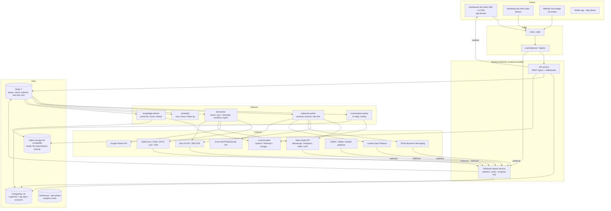

# 04 — System Architecture

> Status: **Proposal v1 — to be finalized** at the technical kickoff. Key decisions are recorded as ADRs in [`adr/`](adr/).
> References: `preny/preny-research/03-kien-truc-cong-nghe/*`, `08-dashboard-thuc-te/11-so-do-dashboard.md`.

## 1. What we know about Preny and how we handle it

| Preny (observed / published) | What we do |
|---|---|
| Website + dashboard on Next.js App Router, next-intl, Axios | **Do not copy.** Dashboard as a Vite + React SPA on a CDN (instant navigation), marketing site on Astro (ADR-009) |
| Separate backend `api.<domain>/api/v1`, header `X-ACCOUNT-ID`, bearer + refresh token | Similar: separate, versioned API, header `X-Workspace-Id`, access/refresh token — but **the server always checks membership** and never trusts the header |
| MongoDB (per their privacy policy) | **Do not copy.** Use PostgreSQL because the credit ledger, orders, and CRM need transactions + relational constraints (see [ADR-002](adr/ADR-002-postgresql.md)) |
| "ChatGPT platform", model labels Smart/Pro/Neo, Neo "coordinates multiple models" | Multi-provider LLM Gateway; Smart/Pro/Neo are **commercial tiers** mapped to pipeline configurations (see [06](06-ai-engine.md)) |
| Queue, vector DB, cloud unknown | Our own design: Redis + BullMQ, pgvector, S3-compatible object storage |

## 2. Architecture principles

1. **Modular monolith first, split into services when there is data to justify it.** One backend codebase divided into modules by domain with clear boundaries (no cross-importing another module's repository — only via service interfaces or domain events). Only 2 things with a very different load profile are split out from day one: **webhook ingress** and **workers**.
2. **Separate 3 load domains** (exactly as analyzed in the Preny dossier): Administration (CRUD, low volume, must have correct permissions) / Conversation processing (latency-sensitive, bursty) / Background tasks (import, campaigns, sync, reconciliation — must never slow down new messages).
3. **Everything goes through idempotent queues.** Webhook received → write `inbound_event` (unique on `channel + external_event_id`) → ack 200 immediately → process async.
4. **Multi-tenant from day 1.** Every business table has `workspace_id`; Postgres Row-Level Security acts as a second line of defense.
5. **Immutable ledger for money/credit/quota.** Never `UPDATE balance = balance - x` without a matching ledger row in the same transaction.
6. **Every AI answer is observable**: trace from message → retrieved knowledge → model/version → prompt version → output → cost.
7. **Versioned configuration**: bot config + knowledge are versioned; every AI message records `bot_version_id`.

## 3. Overall diagram



## 4. Proposed stack

| Layer | Choice | Rationale | Alternative |
|---|---|---|---|
| Language | **TypeScript** throughout (frontend, backend, worker, widget) | One full-stack team, types/DTOs shared via a common package | Go backend if the team is strong in Go |
| Monorepo | **pnpm workspaces + Turborepo** | Build cache, `shared` package | Nx |
| Dashboard | **Vite + React 19 SPA**: TanStack Router (preloading), TanStack Query, TanStack Table + Virtual, **Tailwind v4 + shadcn/ui**, `motion`, `cmdk`, React Hook Form + Zod, i18next; static files on CDN (ADR-009) | Instant client-side navigation, optimistic UI, heavy data tables (CRM/orders); no SEO needed; cheapest layer to scale | Next.js App Router (previous choice, superseded by ADR-009) |
| Marketing site | **Astro** (static, islands) + content collections; same design tokens | Fastest public pages for Vietnamese SEO, industry-specific content, blog, case studies (Preny has ~140 content URLs) | Next.js SSG + headless CMS |
| Backend API | **NestJS** (Fastify adapter), Prisma *or* Drizzle ORM, class-validator/Zod | Modules + DI suit a modular monolith; guards/interceptors for RBAC & tenancy | Plain Fastify |
| Realtime | **Socket.IO** + Redis adapter | Realtime inbox with many staff, typing, assignment | SSE for the widget |
| Queue | **BullMQ** on Redis | Delayed jobs, retry/backoff, per-group rate limiting (per page/OA), repeatable jobs | Kafka at > a few thousand msg/s; Temporal for long workflows |
| Database | **PostgreSQL 16** + pgvector + pg_trgm + unaccent; PgBouncer | Transactions for ledger/orders, JSONB for flexible data, vectors in the same DB reduce operations | Mongo (like Preny) – not recommended |
| Search | Postgres FTS + trigram (Vietnamese unaccent) in the early phase | Sufficient for CRM with a few hundred thousand records/tenant | OpenSearch / Meilisearch when needed |
| Object storage | S3-compatible (AWS S3 / Cloudflare R2 / MinIO / Viettel Cloud Object Storage) | Bot media, import files, attachments, exports | — |
| Analytics | Postgres materialized views → **ClickHouse** at scale | Conversation/order/campaign statistics | — |
| LLM | Internal LLM Gateway (`ai-core` package) calling multiple providers; Vercel AI SDK or native SDKs | Switch models without changing business code, fallback, cost measurement | LiteLLM proxy |
| Embedding | A multilingual model with good Vietnamese support (candidates: OpenAI text-embedding-3-small/large, Gemini embedding, self-hosted bge-m3) | Chosen via a Vietnamese eval set, not by gut feeling | — |
| Auth | Built in-house (JWT access 15', refresh token rotation stored in DB, 2FA TOTP) + Google OAuth login | Need tight control over workspace/role | Keycloak / Clerk |
| Observability | OpenTelemetry → Grafana (Tempo, Loki, Prometheus/Mimir); **Sentry**; **Langfuse** (self-hosted) for LLM traces | Trace across webhook → worker → LLM → outbound | Datadog |
| Infrastructure | Docker; early phase: VM + docker compose or managed (ECS/Cloud Run); wider production: **Kubernetes** | See [10](10-operations-and-deployment.md) | — |
| CI/CD | GitHub Actions / GitLab CI, Terraform, Argo CD (once on K8s) | — | — |

> Note on Vietnamese data: if selling to large enterprises/state organizations, host the primary infrastructure in Vietnam (Viettel IDC, VNG Cloud, FPT Cloud…) and clearly document data flows abroad (LLM providers) in accordance with the personal data protection (BVDLCN) law. See [09](09-security-and-compliance.md).

## 5. Backend modules (bounded contexts)

| Module | Responsibility | Main tables (see [05](05-data-model.md)) |
|---|---|---|
| `identity` | Sign-up, login, email/phone OTP, 2FA, sessions, user profile | users, sessions, otp_codes |
| `workspace` | Workspaces, members, invitations, roles, permissions, customer distribution rules | workspaces, members, roles, assignment_rules |
| `billing` | Plans, entitlements, quotas, subscriptions, AI wallet, ZBS wallet, ledger, vouchers, payments, invoices | plans, subscriptions, wallets, ledger_entries, payments, vouchers, usage_counters |
| `bot` | Bots, basic/advanced configuration, reply schedule, versions, edit history | bots, bot_versions, bot_settings, bot_audit |
| `knowledge` | FAQ, documents, situation guides (scripts), bot products, media albums, quick replies, indexing | knowledge_items, knowledge_chunks, bot_products, media_albums, media_assets, quick_replies |
| `channel` | Channel connections (FB page, IG, Zalo OA, TikTok, Lazada, website widget), tokens, webhooks, status | channel_connections, channel_tokens, inbound_events |
| `conversation` | Conversations, messages, bot ON/OFF status, assignment, handoff, history sync | conversations, messages, conversation_assignments, handoffs |
| `ai` | Reply orchestrator, tool calling, guardrails, AI tagging, phone number (SĐT)/address extraction, metering | ai_runs, ai_tool_calls |
| `crm` | Customers, multi-channel identity, sources, statuses, tags, customer lists (segments), notes, tasks/reminders, files, timeline, CRM automation rules, import/export | contacts, contact_identities, sources, pipeline_statuses, tags, segments, notes, tasks, crm_rules |
| `commerce` | Operational catalog, variants, inventory, orders, fulfillment status, orders from chat, order settings, Google Sheet sync | products, product_variants, warehouses, inventory, orders, order_items, order_settings |
| `shipping` | Carrier connections, waybill creation, status webhooks, COD, reconciliation | carrier_accounts, shipments, shipment_events, cod_reconciliations |
| `marketing` | ZBS/ZNS campaigns, FMM, email, templates, audiences, Tool Ads (chat-opening JSON), CAPI | campaigns, campaign_recipients, message_templates, ad_entry_payloads, conversion_events |
| `automation` | Template-based workflows (silence chase-up, soft follow-up, after-sales, Zalo template), triggers, stop conditions, run log | workflows, workflow_runs, workflow_steps_log |
| `analytics` | Conversation, order, campaign, and AI usage statistics | rollup tables / ClickHouse |
| `notification` | In-app notifications, email, push, reminder milestones (0 min/2h/24h) | notifications, notification_prefs |
| `support` | Support tickets, attachments | tickets, ticket_messages |
| `affiliate` | Terms, referral links, referred customers, commissions, withdrawals, bank accounts | affiliate_accounts, referral_links, referrals, commissions, payouts |
| `admin` (back-office) | Internal administration: tenants, plans, bank-transfer payment approval, support, feature flags, audited impersonation | — |
| `audit` | Immutable activity log | audit_events |

Inter-module communication: synchronous in-process service interface calls + **domain events** (outbox pattern → BullMQ) for side effects (e.g. `message.received` → CRM rule, workflow trigger, analytics).

## 6. Inbound message processing flow (hot path)

```mermaid
sequenceDiagram
  participant P as Platform (FB/Zalo/...)
  participant H as Webhook ingress
  participant DB as Postgres
  participant Q as BullMQ
  participant C as conversation-worker
  participant AI as AI orchestrator
  participant O as outbound-worker
  participant RT as Realtime (Socket.IO)

  P->>H: POST webhook (signature)
  H->>H: Verify signature (X-Hub-Signature-256 / Zalo mac)
  H->>DB: INSERT inbound_events ON CONFLICT DO NOTHING
  H-->>P: 200 OK (< 1s)
  H->>Q: enqueue process-event (jobId = event id)
  Q->>C: process-event
  C->>DB: upsert contact_identity, contact, conversation; insert message
  C->>RT: emit message.new to inbox
  C->>C: Acquire conversation lock (Redis, per conversation_id)
  C->>C: Debounce 2–4s to batch consecutive messages
  alt Bot ON, within reply schedule, not taken over by staff, enough credit
    C->>AI: generate(context, bot_version)
    AI-->>C: reply + tool calls + tags + usage
    C->>DB: insert ai_run, ledger debit (idempotent per ai_run_id)
    C->>Q: enqueue send (idempotency key)
  else Human needed
    C->>DB: handoff + assignment
    C->>RT: notify sales
  end
  Q->>O: send
  O->>P: Send API (rate limit per page/OA)
  O->>DB: message.status = sent/failed (+ actionable error)
  O->>RT: emit message.status
```

Requirements: p95 from webhook receipt to sending the AI reply ≤ 8s (excluding configured debounce); webhook ack p99 < 500ms.

**Debounce + lock** solve two classic bugs: the customer sends 3 consecutive messages → the bot replies 3 times; and a new message arrives while the AI is running → the reply is based on stale context. If a new message arrives while the AI is running, the old result is discarded and the run is repeated (comparing `last_message_seq`).

## 7. Staff-initiated outbound flow

Dashboard → `POST /conversations/:id/messages` → save to `messages` (status `queued`, `sender_type=agent`) → enqueue send → outbound-worker → channel. When staff send manually: the **bot is automatically paused** for that conversation for N minutes (configurable, default 5' as in Preny), and the `bot_paused_until` state is clearly shown in the UI.

Staff replies sent *from another platform* (Meta Page inbox, Pancake…) are received via the `message_echoes` webhook → they also trigger "bot silent for N minutes".

## 8. Realtime

- Namespace per workspace; rooms per `workspace:{id}`, `conversation:{id}`, `user:{id}`.
- Events: `message.new`, `message.status`, `conversation.updated` (assign, tag, bot toggle), `typing`, `notification.new`.
- Horizontal scaling via the Redis adapter; sticky sessions at the ingress.

## 9. Multi-tenancy & data partitioning

- Phases 1–2: **shared database, shared schema**, `workspace_id` column + RLS (`SET app.workspace_id` per transaction).
- Large tables (`messages`, `inbound_events`, `ai_runs`, `ledger_entries`, `campaign_recipients`) use **monthly partitioning** (pg_partman) for easy archiving/retention.
- Expansion / Enterprise phase: support a **dedicated database** for large tenants (routing workspace → connection), or Citus if sharding is needed.

## 10. Architecture decisions to finalize

See the ADR list in [`adr/README.md`](adr/README.md) and the open questions in [14](14-open-decisions.md).
