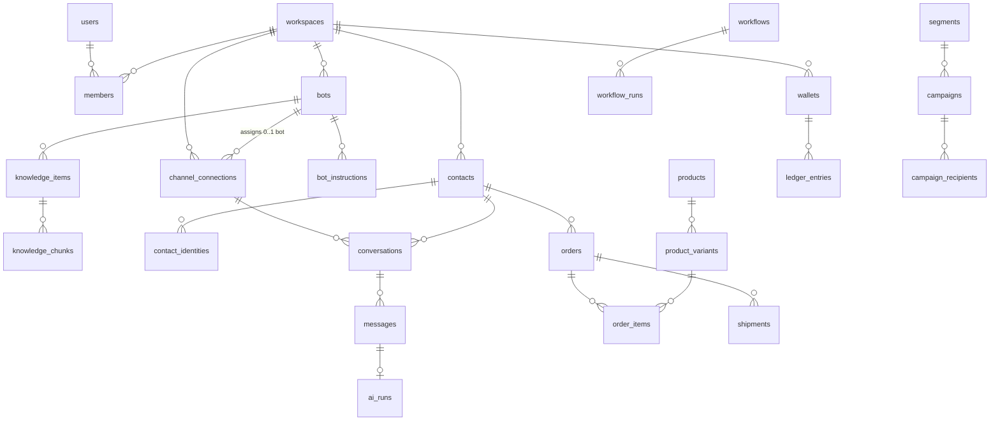

# 05 — Data Model (PostgreSQL)

> Logical design v1. Table/column names in English snake_case. Every business table has `workspace_id` (RLS), `created_at`, `updated_at`; soft delete via `deleted_at` on tables users edit.
> ID: `uuid` (UUIDv7 generated in the app — time-ordered, indexes well). Money: `bigint` VND (no floats). Credit: `bigint` in milli-credit units (1 credit = 1,000 VND ⇒ 1 milli-credit = 1 VND).
> Mapping of Preny entities → our tables: see [`reference/preny-dashboard-spec.md` §13](reference/preny-dashboard-spec.md).

## 1. Relationship diagram (simplified)



## 2. Identity & workspace

```sql
users(id, email CITEXT UNIQUE, email_verified_at, phone, phone_verified_at, password_hash, name, avatar_url,
      timezone DEFAULT 'Asia/Ho_Chi_Minh', locale DEFAULT 'vi', status, totp_secret_enc, totp_enabled_at,
      invoice_info JSONB, last_login_at)
sessions(id, user_id, refresh_token_hash, family_id, user_agent, ip, expires_at, revoked_at)
otp_codes(id, user_id, purpose, channel, code_hash, expires_at, attempts, consumed_at)

workspaces(id, name, logo_url, company_name, business_service, product_description, industry,
           owner_user_id, status, timezone, settings JSONB,      -- notification offsets ≤5, assignment_mode…
           referral_code, referred_by_affiliate_id, deleted_at)
members(id, workspace_id, user_id, role_id, status: invited|active|disabled, invited_by, joined_at,
        UNIQUE(workspace_id, user_id))
roles(id, workspace_id NULL=system, key, name, permissions TEXT[], is_system)
member_scopes(member_id, scope_type: channel|all, scope_id)        -- Sales only see assigned pages
invitations(id, workspace_id, email, role_id, token_hash, expires_at, accepted_at)
assignment_rules(id, workspace_id, mode: off|by_channel|by_ratio|by_ratio_daily, config JSONB, only_online BOOL)
```

## 3. Bot & knowledge

```sql
bots(id, workspace_id, name, industry, avatar_url, color, language, model_tier: basic|smart|pro|neo,
     is_active BOOL, published_version_id, onboarding JSONB, deleted_at)
bot_versions(id, bot_id, version INT, snapshot JSONB,            -- settings + mission + greeting + instructions ids
             published_at, published_by)
bot_settings(bot_id PK, mission TEXT, greeting JSONB, reaction_reply JSONB,
             reply_first_message BOOL, reply_comments BOOL, comment_to_messenger BOOL,
             reply_speed, creativity, classify_instructions VARCHAR(2000),
             fallback_enabled BOOL, fallback_message VARCHAR(1000), handoff_message,
             self_pronoun, customer_pronoun, use_customer_name BOOL, smart_pronoun BOOL, pronouns_by_gender JSONB,
             image_send_mode, image_understanding BOOL, stop_after_contact BOOL,
             silence_on_external BOOL, silence_minutes INT DEFAULT 5,
             auto_reenable BOOL, reenable_minutes INT DEFAULT 5,
             follow_up_24h BOOL, follow_up_on_phone BOOL, allow_general_knowledge BOOL,
             schedule JSONB, off_hours_behavior)
bot_instructions(id, bot_id, workspace_id, title, content, always_on BOOL, position, source: seed|manual|import)
knowledge_items(id, bot_id, workspace_id, type: faq|document|url, question, answer,
                file_key, url, status: pending|indexing|ready|failed, error, content_hash, source, created_by)
knowledge_chunks(id, knowledge_item_id, bot_id, workspace_id, chunk_index, content, content_unaccent,
                 tsv TSVECTOR, embedding VECTOR(1536), token_count, embedding_model)
   -- INDEX HNSW (embedding vector_cosine_ops), GIN(tsv), GIN(content_unaccent gin_trgm_ops)
bot_products(bot_id, product_id, instructions TEXT, position, PRIMARY KEY(bot_id, product_id))
media_albums(id, workspace_id, bot_id NULL, name)
media_assets(id, workspace_id, album_id, kind: image|video|file, storage_key, mime, bytes, width, height, caption)
quick_replies(id, workspace_id, shortcut, content, media_asset_ids UUID[], created_by,
              UNIQUE(workspace_id, shortcut))
bot_audit(id, bot_id, workspace_id, actor_id, category, action, diff JSONB, created_at)
```

## 4. Channels & conversations

```sql
channel_connections(id, workspace_id, kind, external_id, name, avatar_url, bot_id NULL,
                    status: pending|active|inactive|error|revoked, health JSONB,   -- last_error, last_ok_at
                    token_enc BYTEA, token_expires_at, refresh_token_enc, scopes TEXT[], meta JSONB,
                    connected_by, connected_at, UNIQUE(kind, external_id, workspace_id))
inbound_events(id, workspace_id NULL, channel_kind, external_event_id, received_at, payload JSONB,
               status: received|processed|ignored|failed, error, UNIQUE(channel_kind, external_event_id))
               -- monthly partitions, kept for 30 days

contacts(id, workspace_id, display_name, phone_e164, email, gender, birthday, addresses JSONB,
         source_id, ad_ref, owner_member_id, status_id, avatar_url,
         marketing_consent JSONB,            -- {zalo:{state,at}, email:{...}, fb:{...}}
         custom JSONB, last_interaction_at, merged_into_id, deleted_at)
   -- INDEX (workspace_id, phone_e164), (workspace_id, email), GIN trigram on name
contact_identities(id, workspace_id, contact_id, channel_connection_id, kind, external_user_id,
                   profile JSONB, UNIQUE(channel_connection_id, external_user_id))

conversations(id, workspace_id, channel_connection_id, contact_id, contact_identity_id,
              kind: dm|comment, status: open|pending|closed, assignee_member_id,
              bot_enabled BOOL, bot_paused_until, handoff_state: none|requested|accepted, handoff_reason,
              summary TEXT, extracted JSONB,        -- phone/address/name/gender extracted by AI
              last_message_at, last_inbound_at, last_message_seq BIGINT, unread_count,
              is_test BOOL, window_expires_at)
conversation_tags(conversation_id, tag_id, added_by, added_at)
messages(id, workspace_id, conversation_id, seq BIGINT, direction: in|out,
         sender_type: contact|bot|agent|external|system, sender_member_id, external_message_id,
         type: text|image|video|file|sticker|reaction|product_card|album|template|comment,
         text, attachments JSONB, payload JSONB, reply_to_id,
         status: queued|sent|delivered|read|failed, error_code, error_detail,
         ai_run_id, idempotency_key UNIQUE, note TEXT, created_at)
   -- monthly partitions; INDEX (conversation_id, seq)
ai_runs(id, workspace_id, bot_id, bot_version_id, conversation_id, trigger_message_id,
        tier, provider, model, prompt_version, input_tokens, output_tokens, cached_tokens,
        latency_ms, cost_micro_usd, cost_vnd, charged_milli_credit,
        retrieved JSONB, tool_calls JSONB, guardrail JSONB, outcome: replied|handoff|skipped|error,
        is_test BOOL, created_at)                          -- monthly partitions
fb_posts(id, workspace_id, channel_connection_id, external_post_id, message, auto_reply_enabled, ...)
```

## 5. CRM

```sql
sources(id, workspace_id, key, name, icon, is_default)            -- 7 defaults
pipeline_statuses(id, workspace_id, name, color, position, is_won, is_lost)
tags(id, workspace_id, name, color, type: attribute|task|label, fields JSONB,   -- attribute schema
     note, is_system, is_quick, created_by)
contact_tags(contact_id, tag_id, values JSONB, due_at, done_at, assignee_member_id, created_by, created_at)
notes(id, workspace_id, contact_id, conversation_id NULL, message_id NULL, body, created_by)
tasks(id, workspace_id, contact_id, title, due_at, remind_offsets INT[], assignee_member_id, done_at)
contact_files(id, workspace_id, contact_id, storage_key, name, bytes)
contact_events(id, workspace_id, contact_id, type, data JSONB, actor_id, created_at)   -- timeline
segments(id, workspace_id, name, type: system|dynamic|static|import, filter JSONB, member_count, refreshed_at)
segment_members(segment_id, contact_id)                           -- for static/import
crm_rules(workspace_id, key, enabled, config JSONB)               -- 9 rules
crm_rule_runs(id, workspace_id, rule_key, conversation_id, contact_id, result, created_at)
import_jobs(id, workspace_id, kind, file_key, mapping JSONB, status, total, ok, failed, error_file_key)
```

## 6. Commerce & shipping

```sql
products(id, workspace_id, code, name, description, images JSONB, status, visible_to_bot BOOL,
         category, UNIQUE(workspace_id, code))
product_variants(id, product_id, workspace_id, sku, options JSONB, price BIGINT, cost BIGINT,
                 weight_gram INT, barcode, UNIQUE(workspace_id, sku))
warehouses(id, workspace_id, name, phone, province_code, ward_code, address_detail, is_default)
inventory(variant_id, warehouse_id, on_hand INT, reserved INT, PRIMARY KEY(variant_id, warehouse_id))
inventory_movements(id, workspace_id, variant_id, warehouse_id, delta, reason, ref_type, ref_id)

orders(id, workspace_id, code,                     -- display code, incrementing per workspace
       source_id, channel_connection_id, conversation_id, contact_id, warehouse_id,
       status, extra_flags JSONB,
       customer JSONB, recipient JSONB, expected_delivery_at,
       subtotal, discount_type, discount_value, discount_amount, shipping_fee, shipping_fee_charged,
       surcharge, transfer_amount, total, amount_due, paid, remaining, cod_amount, free_shipping BOOL,
       note_internal, note_print, created_by_member_id, created_by_kind: agent|bot|import|api,
       placed_at, confirmed_at, cancelled_at, gsheet_synced_at, capi_sent_at,
       idempotency_key UNIQUE, deleted_at)
order_items(id, order_id, variant_id, name_snapshot, sku_snapshot, qty, unit_price, discount, line_total)
order_status_history(id, order_id, from_status, to_status, note, actor_id, created_at)
order_settings(workspace_id, source_id NULL, extra_statuses TEXT[], require_note TEXT[], require_confirm TEXT[],
               create_conditions JSONB, confirm_conditions JSONB, gsheet JSONB, chat_order JSONB, ads_optimization JSONB)
shipping_settings(workspace_id, source_id NULL, free_ship_if_fully_paid BOOL, lock_send_status, status_on_send,
                  inner_city_days, outer_city_days, custom_inner_wards JSONB)
carrier_accounts(id, workspace_id, carrier, name, credentials_enc, status, meta JSONB)
shipments(id, workspace_id, order_id, carrier_account_id, tracking_code, status, fee, cod_amount,
          request_key UNIQUE, label_url, raw JSONB, created_at)
shipment_events(id, shipment_id, status, raw_status, occurred_at, payload JSONB)
admin_units(code, name, level: province|ward, parent_code, valid_from, valid_to)   -- 2-level administrative boundaries after the merger
```

**Order amount formulas** (match the Preny form, must be unit-tested):

```
subtotal          = Σ line_total
discount_amount   = discount_type == 'percent' ? round(subtotal × value / 100) : value
after_discount    = subtotal − discount_amount
total             = after_discount + shipping_fee_charged + surcharge     -- "Tổng số tiền" (Total amount) / "Tiền cần thu" (Amount to collect)
paid              = transfer_amount (+ other payments)
remaining         = total − paid                                          -- "Còn thiếu" (Outstanding)
cod_amount        = max(remaining, 0)
free_shipping     ⇒ shipping_fee_charged = 0 (shop absorbs shipping_fee)
profit (statistics) = Σ(unit_price − cost) × qty − discount_amount − (shipping_fee − shipping_fee_charged)
```

## 7. Marketing & automation

```sql
message_templates(id, workspace_id, channel: zbs|email|fb, external_template_id, name, body, variables JSONB,
                  status: draft|pending|approved|rejected, reject_reason, price_milli_credit)
campaigns(id, workspace_id, channel, name, template_id, segment_id, channel_connection_id,
          status, scheduled_at, started_at, finished_at, estimated_cost, held_amount,
          stats JSONB,  -- total, eligible, sent, failed, delivered, read, clicked
          created_by)
campaign_recipients(id, campaign_id, workspace_id, contact_id, address, variables JSONB,
                    status: pending|skipped|sent|delivered|failed, skip_reason, error, external_message_id,
                    cost_milli_credit, sent_at, UNIQUE(campaign_id, contact_id))   -- partition
ad_entry_payloads(id, workspace_id, bot_id, kind, input JSONB, json TEXT, created_by)
conversion_events(id, workspace_id, order_id, platform, event_name, event_id UNIQUE, payload, response, status, sent_at)

workflows(id, workspace_id, template_key, industry, name, description, goal, trigger JSONB,
          steps JSONB,             -- [{delay, channel, message|template, conditions}]
          stop_conditions JSONB, channel_kinds TEXT[], status: draft|published|paused, version)
workflow_runs(id, workflow_id, workspace_id, contact_id, conversation_id, status: active|completed|stopped|goal_reached,
              current_step, next_run_at, stop_reason, started_at, ended_at, attributed_order_id)
workflow_run_logs(id, run_id, step, action, result, message_id, created_at)
```

## 8. Billing, affiliate, support, system

```sql
plans(id, code, name, version, is_public, prices JSONB /* {3:..,6:..,12:..} */, entitlements JSONB)
subscriptions(id, workspace_id, plan_id, plan_version, period_months, status, current_period_start,
              current_period_end, cancel_at, trial_end)
entitlement_overrides(id, workspace_id, key, value JSONB, reason, expires_at, created_by)
usage_counters(workspace_id, key, period_start, used BIGINT, PRIMARY KEY(workspace_id, key, period_start))
wallets(id, workspace_id, type, balance BIGINT, held BIGINT, status, UNIQUE(workspace_id, type))
ledger_entries(id, wallet_id, workspace_id, kind, amount BIGINT, balance_after BIGINT,
               ref_type, ref_id, feature, idempotency_key UNIQUE, created_by, meta JSONB, created_at)  -- partition
payments(id, workspace_id, purpose: subscription|topup_ai|topup_zbs|addon, invoice_no, amount_before_vat, vat,
         amount, method: vnpay|bank_transfer|momo|manual, provider_ref, status: pending|paid|failed|refunded,
         approval_status: auto|pending|approved|rejected, paid_at, raw JSONB)
invoices(id, workspace_id, payment_id, number, buyer JSONB, file_key, einvoice_ref, issued_at)
vouchers(id, code UNIQUE, effect JSONB, valid_from, valid_to, max_redemptions, per_workspace_limit, plan_codes TEXT[])
voucher_redemptions(id, voucher_id, workspace_id, payment_id, redeemed_at)

affiliate_accounts(id, user_id, terms_version, terms_accepted_at, bank_info_enc, balance BIGINT)
affiliate_links(id, affiliate_id, code UNIQUE, commission_rule_id, status)        -- ≤5 per affiliate
affiliate_clicks(id, link_id, ip_hash, ua, created_at)
referrals(id, affiliate_id, link_id, workspace_id, signed_up_at, status)
commissions(id, affiliate_id, referral_id, payment_id, amount, status: pending|approved|paid|reversed)
payouts(id, affiliate_id, amount, status, bank_snapshot_enc, paid_at)

tickets(id, workspace_id, created_by, subject, department, status, priority, sla_due_at)
ticket_messages(id, ticket_id, author_type, author_id, body, attachments JSONB)
notifications(id, workspace_id, user_id, type, title, body, link, read_at, created_at)
audit_events(id, workspace_id, actor_type, actor_id, action, target_type, target_id, ip, ua, before, after, created_at)
outbox_events(id, aggregate, aggregate_id, type, payload, created_at, published_at)   -- outbox pattern
feature_flags(key, workspace_id NULL, value JSONB)
```

## 8b. Vertical objects and tenant extensibility

`resources`, `availability_rules`, `services`, `appointments`, `quote_forms`, `price_rules`, `quotes`, `applications`, `application_documents`, `custom_field_definitions`, `vertical_packs`, `workspace_packs` — defined in `docs/17-multi-tenancy-and-verticals.md` §4. `products.catalog_kind` distinguishes products / services / rooms / courses / menu / spec products on the single catalog. `packages/db` also ships the workspace→database connection router described in `docs/17` §6 from the first migration.

## 9. Key data rules

1. **Normalize phone numbers (SĐT)** to E.164 (`+84…`) on save; display as `09xx…`.
2. **Customer dedup**: soft uniqueness on (`workspace_id`, `phone_e164`) — not a hard constraint because some customers share a phone number; merge via `merged_into_id`, preserving history.
3. **Message sequence** `messages.seq` increases monotonically per conversation (taken from `conversations.last_message_seq` + 1 within the transaction) → lets the AI detect stale context.
4. **Snapshot** name/price/SKU in `order_items` — editing the catalog does not change existing orders.
5. **Partition** fast-growing tables by month; a retention job drops old partitions according to the plan's policy.
6. **Migrations**: only versioned migrations (Prisma Migrate / Drizzle Kit); migrations must not lock large tables (add nullable column, backfill in batches, then set NOT NULL).
7. **Seed data**: industry templates (FAQ, situations, workflows), 7 sources, 8 statuses, 4 system tags, 9 CRM rules, administrative unit catalog, plans & pricing.
