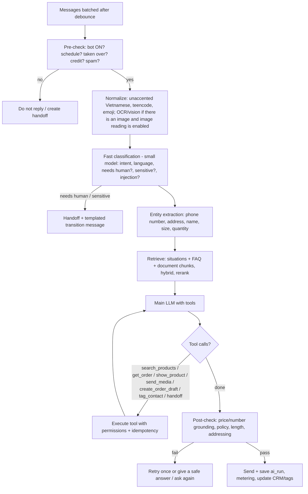

# 06 — AI Engine (sales bot)

> This is the differentiating part and also the riskiest. Goal: **answer correctly from the shop's own data, never fabricate prices/stock/policies, know when to ask again or hand off to a human, and produce actions (leads, tags, orders)**.
> References for verified Preny behavior: `08-dashboard-thuc-te/02-bot-ai-va-huan-luyen.md`, `09-ket-qua-thu-nghiem.md`.

## 1. Preny behavior to reproduce (baseline)

| Observed behavior | Our requirement |
|---|---|
| FAQs asked verbatim and paraphrased are both answered correctly | Semantic + keyword (hybrid) retrieval |
| SKU without data → "cần kiểm tra lại" (needs to be checked), no number given | Guardrail "no source, no number" |
| Asking about a declared product → correct price + **product card** | Tool `show_product` returns a rich message |
| A new bot comes with 6 FAQs + 3 sample situations per industry | Industry templates when creating a bot |
| 4-step readiness checklist (FAQ, guidance, products, integrations) | Onboarding checklist |
| Test chat right in the dashboard; test conversations show up in the inbox as "Website / Test User" | Sandbox chat — **but flagged `is_test=true`, not counted in customer statistics/quota** (an improvement over Preny) |
| Advanced settings (see §6) | All become versioned `bot_settings` |
| Model labels Smart / Pro / Neo, priced at 110/150/195 VND per reply; Bot V1/2/3 = 60 VND | Commercial tier → pipeline configuration (see §7) |

## 2. Knowledge layers

| Layer | Input source | How it is used at runtime |
|---|---|---|
| **Bot instructions (system)** | Main mission, greeting, addressing style, reactions | Always in the system prompt |
| **Situations (scripts)** | A list of "when the customer … the bot …" (opening hours, branches, step-by-step consulting process) | Retrieve top-k by relevance; situations marked `always_on` are always included |
| **FAQ / information** | Manual entry, Excel/CSV import, Excel export | Hybrid retrieval (vector + trigram/BM25); FAQ answers get high priority |
| **Documents** | PDF, DOCX, TXT, website URL (crawl) | Parse → chunk (~500 tokens, overlap 50) → embed |
| **Bot products** | Name, code, price (text), description, images, per-product instructions; or a **link to the operational catalog** | Tool `search_products` (structured); the full catalog is never put into the prompt |
| **Media albums** | Images/videos by album | Tool `send_media(album/asset)`; sent as a gallery of up to N images |
| **Live data** | Operational catalog, stock, the customer's orders, waybill status | Read-only tools scoped to the current customer |

**Mandatory improvement over Preny:** Preny separates "bot products" and the "order catalog" — products added to the bot do not appear in the order form. We design **a single catalog** (`products`); the bot only has a `visible_to_bot` flag + its own `bot_instructions`. Price the AI quotes = price in the catalog = price on the order.

## 3. Single-turn processing pipeline

### 3.1 Context build

- System prompt = system frame (immutable, written by us) + bot instructions (the shop's) + safety rules + per-channel output format.
- History: the last N turns (default 20 messages or ≤ 3k tokens) + a **summary of older conversation** updated at the end of each turn (stored in `conversations.summary`).
- Customer profile: name, form of address, gender (if the channel provides it), tags, status, most recent order.
- Retrieved knowledge: sources are marked `[[kb:<id>]]` for post-checking and for showing the bot configurator "which sources the answer used" (Preny lacks this).

### 3.2 Tools (function calling)

| Tool | Description | Safety notes |
|---|---|---|
| `search_products(query, filters)` | Search products/variants, prices, stock | Read-only, workspace-scoped |
| `show_product(product_id)` | Send a product card (image, name, price, buttons) | Rendered per channel: FB generic template, Zalo list, widget card |
| `send_media(album_id | asset_ids)` | Send images/videos | Limit of N images per turn |
| `get_customer_orders()` | Orders + waybills of the current customer | Only the customer of this conversation |
| `collect_contact(phone, address, name)` | Save phone number/address to CRM | Validate Vietnamese phone numbers (10 digits, carrier prefix) |
| `create_order_draft(items, shipping)` | Create a **draft order** from chat | The bot does not confirm orders on its own unless settings allow it; always reads the order summary back to the customer for confirmation; idempotency on `conversation_id + cart_hash` |
| `tag_contact(tag)` | Apply a tag (VIP, interested, red tag "không trả lời được" (could not answer)...) | Only tags allowed for AI |
| `handoff(reason, summary)` | Hand off to a human + summary + open questions | Stops the bot on the conversation |
| `create_appointment(slot, resource?)` *(P0 request-only, P1 with availability)* | Appointment request / booking for scheduled-service verticals | P0 records `requested`; P1 checks `check_availability` first and never double-books |
| `check_availability(service, date_range)` *(P1)* | Free slots from `resources` + `availability_rules` | Deterministic query, no LLM arithmetic |
| `estimate_price(form_id, inputs)` / `create_quote(...)` *(P1)* | Quotes for long-decision verticals (furniture, real estate, solar/mechanical B2B) | Price comes only from tenant `price_rules`; quote needs human approval before it is binding |
| `collect_document(type)` *(P2)* | Eligibility/application flows (finance, study abroad, labor export) | Documents to tenant-prefixed storage; no eligibility promise by the bot |

Tool availability per workspace is declared by its vertical pack (`docs/17` §3); tools not in the pack are not exposed to the model.

### 3.3 Guardrails

1. **Number grounding**: every price/stock/fee/% figure in an answer must appear in the retrieved sources or tool results; otherwise → rewrite as "để em kiểm tra lại" (let me check that again) (matches Preny behavior T06).
2. **No-commitment policy**: a configurable list of things the bot must not promise on its own (discounts outside programs, guaranteed delivery times…).
3. **Prompt injection**: customer content + document content are wrapped in delimiters, and the system frame explicitly says not to follow instructions found in data; an injection classifier → safe answer.
4. **"Tag đỏ" (Red tag)**: when the bot cannot answer → apply the red tag + (depending on settings) handoff; used as a workflow trigger and for an "unanswered questions" report so the shop can add FAQs — **a knowledge-improvement loop**.
5. **PII**: do not send card numbers, national ID (CCCD) numbers… to the LLM if detected; mask them in logs.
6. **Cost limits**: max tool iterations (5), max output tokens, 20s timeout → fall back to a cheaper model or hand off.

## 4. Retrieval

- Index: `knowledge_chunks(embedding vector(1024|1536), tsv, text_unaccent)` with an HNSW index.
- Hybrid query: vector top 20 + trigram/FTS top 20 → **Reciprocal Rank Fusion** → rerank (rerank model or small LLM) → top 5–8.
- Vietnamese: store an unaccented version (`unaccent`) in parallel so customers typing without diacritics still get hits.
- Re-index when FAQs/documents are edited (job `knowledge.reindex`); versions tied to `bot_version`.
- Answer caching: **do not** cache answers containing live data; only cache query embeddings.

Retrieval index strategy (revised after review): for the typical bot (< 10 k chunks) use an exact scan over `(bot_id)` — no HNSW, no recall loss; add a partial HNSW index only above a threshold, with pgvector ≥ 0.8 iterative scans; store embeddings per model so model changes do not force a rebuild. Admission control, per-tenant token budgets and prompt-cache layout are specified in `docs/16` §2b and are part of `ai-core`, not of individual tools.

## 5. Classification & extraction for CRM

Runs after each turn (small, cheap model, async, does not block the reply):

- Classify the customer according to the shop's **"hướng dẫn phân loại khách"** (customer classification guide) → assign status/tag (e.g. Tham khảo (Browsing), Quan tâm (Interested), Chốt đơn (Closed order)).
- Extract phone number, address (normalized to province/district/ward per the new administrative catalog after the 2025 merger — requires an up-to-date data table), email.
- Detect hashtags/ad codes (ref param from ads, `#code` in the first message) → customer source + ad code.
- Results flow through `crm_rules` (see [02](02-functional-requirements.md) §CRM automation).

## 6. Bot settings (full clone of Preny)

**Basic:** name, avatar, color (widget), language, model tier, reply schedule (by day of week, time slots, outside hours → off-hours message or keep replying).

**Advanced:**

| Group | Setting | Default |
|---|---|---|
| Scope | Reply to first message; reply to comments; proactively message on Messenger when there is a comment (private reply) | On / Off / Off |
| Pacing | Reply speed: Instant / simulated typing (delay by length) | Instant |
| Creativity | Strict / Balanced / Creative (→ temperature + how much the LLM may use general knowledge) | Balanced |
| Classification | Customer classification guide (prompt) | Industry template |
| Not understood | Reply when not understood; template message for transferring to staff | Template |
| Addressing | Fixed self/customer pronouns; include customer name; by gender (if the channel provides it) | "em" (self) / "anh/chị" (customer) |
| Media | Send images as a gallery (up to the first 30 images); read images sent by the customer (vision) | On |
| Stop | Stop replying once full contact information is collected | Off |
| Human coordination | Stay silent N minutes when someone replies from another platform; auto re-enable after N minutes when staff reply manually | 5' / 5' |
| Follow-up | Follow up within 24h (nudge silent customers); follow up after a phone number is obtained | Off |
| Use LLM knowledge | Allow answering beyond the data (general knowledge) | Off |

Every change → a `bot_audit` record (who, when, diff) — Preny's "Lịch sử chỉnh sửa" (Edit history) screen is empty; we must actually implement it.

## 7. Model tiers & LLM Gateway

A tier is a **configuration bundle**, not a hard-coded model name:

| Tier | Pipeline | Example configuration (finalized by eval, updated per provider pricing) | Selling price per reply (Preny reference) |
|---|---|---|---|
| Basic (V1–V3) | No tools, FAQ only + small model | Smallest model that passes the FAQ eval | 60 VND |
| Smart | 1 mid-range model + tools + retrieval | E.g. `claude-haiku-5-5` / GPT mini / Gemini Flash | 110 VND |
| Pro | Stronger model + rerank + vision | E.g. `claude-sonnet-5-5` / equivalent | 150 VND |
| Neo | Multi-model: small model classifies → strong model answers → verifier model cross-checks facts (matching the description "Neo coordinates multiple models, controls facts") | Router + verifier | 195 VND |

**Where the mapping lives (implemented, M2):** platform admins manage providers and tier routes in the admin console (`/admin/llm/*`, tables `llm_providers` + `llm_tier_routes`, docs/05 §8). A provider is either `anthropic` (Messages API) or `openai_compatible` (any `/v1/chat/completions` server: OpenAI, or self-hosted vLLM / SGLang / Ollama / llama.cpp / LiteLLM via `base_url`). Each tier has a primary `provider + model + effort` and an optional fallback on another provider. API keys are encrypted with `SECRETS_ENCRYPTION_KEY` (docs/09 §5) and never returned by the API. The runtime reloads the configuration within 10 s of a change (immediately in the process that saved it). The admin dialog can check a connection before saving and list a server's models (`POST /admin/llm/providers/models`, which needs no model id). A tier without a usable route answers `503 AI_UNAVAILABLE` in production; development and tests use a deterministic fake model. For `hermes` providers the admin page also shows a "ChatGPT account" panel: `GET|POST|DELETE /admin/llm/providers/{id}/hermes-login` proxy the bridge's `/v1/auth/{status,start,logout}` (OAuth device-code flow; the server unseals the bridge key, tokens never reach NestJS or the browser). Model names in the table above are starting points, not defaults in code.

**Playground (M2):** `POST /bots/{botId}/playground` runs the single-turn pipeline without channels: FAQ retrieval (trigram, top 5, placeholders filled; FAQs with unfilled placeholders are never sent), prompt `sales-agent@9` (T-143; `sales-agent@8` stays available through the `promptVersion` option) with structured output `{outcome, reply, sources, imageIds}` (plus `actionId`/`args` and the outcomes `call_action`, `confirm_action`, `cancel_action` when the bot has API actions, see below), then guardrails — refusal → handoff message, invalid output → one retry, then the fallback message with guardrail `invalid_output:<empty|not_json|schema>` (category only; a code fence or prose around the JSON is tolerated), truncated output → fallback message, `unknown` → the bot's fallback message, any figure whose amount is not in the sources or bot settings → fallback (§3.3 rule 1; amounts are compared with their unit, so "42" never vouches for "42k", and the customer's own text may vouch only for non-money figures such as sizes). Fallback never sends model text. Handoff always sends the bot's handoff message (built-in when empty), optionally preceded by one brief model sentence (at most 200 characters, no ungrounded figure) so an upset customer gets an apology before the hand-over; otherwise the lead-in is dropped. Built-in messages use the bot's language and pronouns.

Prompt behaviour (`sales-agent@8`): customer images (Hermes only, `images` on the request, max 3 of 3 MB, last customer message) are used only to work out what the customer means and match it to the blocks; price, stock and policy never come from an image, and an unclear image gets a short description plus a clarifying question. A non-Hermes provider rejects `images` (the channel pipeline then retries text-only). Other rules: scenario situations (title, "Khi" trigger line, handling) are authoritative: a matching situation is followed with outcome `answer` unless it says to hand over (then `handoff`); the generic handoff rule applies only when no situation does. Only scenarios with `enabled` reach the model, grouped inside `<shop_situations>` under a `## General rules` header and, when present, an `## After an order …` header for `section = after_order` rules (apply right after an order or booking was just completed or confirmed, e.g. a successful action call); see `training-workspace.md`. At most 20 enabled rules are sent, the oldest first (by creation time); when the block would exceed 20,000 characters each rule is cut to a common length instead of the tail being dropped, so both headers and every rule survive. Rule text counts as trusted text for the number guardrail, so starter rules carry no sample prices (a "99k" example would vouch for an invented price). The bot uses its configured pronouns (never "shop"/"tôi" for itself), greets only in its first reply (any earlier assistant or staff message in the history counts: then it never opens with a greeting or "chào"), answers every question of the customer's latest messages in one reply, in order, briefly (the channel pipeline merges all consecutive customer messages after the last bot/staff reply into one customer turn), answers a phone number the customer gives with outcome `handoff` and a one-sentence confirmation of the number (conversation switches to human mode, so staff see it; the bot never says it will call), and follows per-product instructions such as "ask for the size before quoting".

**Bot-sent pictures (T-053).** Per turn the AI module builds an allowlist of at most 10 pictures `{id, label, url}` from (a) the retrieved products' `imageUrls` (id `p:<productId>:<index>`, label = product name, `(i/n)` when there are several) and (b) image-library items (`media` training items) whose title or trigger shares a meaningful word with the customer's text (id `m:<itemId>`; filler such as "xem", "ảnh", "hình" does not count). The model sees only a compact block `Images you may send (id: label)` on the last customer turn — never a URL — and the prompt allows `imageIds` (max 3) only when the customer asks to see a picture. The server resolves the ids: ids outside the allowlist (invented, URL-looking, from another turn) are dropped, duplicates collapse, at most 3 remain, in the order requested; the result is `images: {url, label}[]` on the AI response (also returned by the playground), and only for an `answered` outcome (a fallback or handoff sends no pictures). Every URL therefore comes from our own stored https data. The retrieval words of the catalog search ignore picture-request filler and the search keeps up to 8 terms, so a product named late in a merged multi-question turn is still found. Delivery is described in `meta-inbox.md`. Known gap: a product without pictures gets no allowlist entry, so "show me the photo" may end in the generic fallback instead of "no photo yet".

Contract of `fallback`: it means "no grounded answer, the customer was told so" and is the bot's `fallbackMessage`. The AI engine does not hand the conversation over on `fallback`; only `handoff` switches the conversation to human mode (the caller does that). The default fallback wording therefore promises nothing the system does not do ("Dạ, em chưa có thông tin này ạ. Anh/chị nhắn rõ hơn hoặc để lại số điện thoại để nhân viên hỗ trợ giúp mình nhé."; a phone number then triggers a handoff; bots created earlier keep their stored text); the owner can write one if they want (then they also accept that staff must watch the inbox). Automatic handoff on repeated fallbacks and the "red tag" are not built yet (§3.3 rule 4).

Known limitation: retrieval and product lookup are Vietnamese-only. For a customer writing in another language (for example English) the bot, when the blocks give it nothing, answers one short polite sentence in that language: the shop replies in Vietnamese, so please write in Vietnamese or share a phone number. It promises no follow-up, call-back or staff action, because the conversation stays in bot mode and nobody is alerted. This is only a courtesy sentence, and no translation of questions or knowledge is attempted. Each turn writes an `ai_runs` row (`is_test = true`, never charged) with tokens, latency, retrieved sources and which ones were cited. It runs in the api process because it is request/response; channel conversations will run the same pipeline in the agent process (M3).

Gateway (`packages/ai-core`):
- Unified interface `generate({messages, tools, model_policy})`, optional streaming.
- Per-tier fallback chain on provider errors/timeouts; circuit breaker.
- Writes `ai_runs`: provider, model, prompt_version, input/output tokens, cached tokens, latency, cost_vnd (per internal price table), guardrail results.
- Prompt caching of the system part + stable knowledge to reduce cost.
- Never send data to providers whose policy uses it for training; sign DPAs with providers.

**Customer billing unit**: 1 "AI message" = 1 bot reply sent out (internal tool loops and background classification are not counted). We must track **actual COGS per AI message** per tier; target AI gross margin ≥ 60%.

## 8. Quality evaluation (eval) — mandatory before every model/prompt change

- Vietnamese eval set of ≥ 300 cases at the MVP stage, growing by industry: correct FAQ, paraphrasing, unaccented/teencode/typos, multiple intents, changing mind midway, missing data, out of scope, injection, handoff, order creation, price changes.
- Scoring: exact-match for facts (codes, prices), LLM-as-judge with a rubric for style, checking tool calls have correct parameters.
- Release-blocking thresholds: 0 critical errors (wrong price, fabricated policy, wrong order created) on the "critical" set; ≥ 90% on the common set.
- Runs in CI (nightly + on changes to `prompts/` or the model map). Details in [13](13-testing-and-quality.md).
- Production: sample 1–2% of conversations for review; staff 👍/👎 buttons + "edit answer" → suggest new FAQs (requires approval, no self-learning).

## 9. Abuse & cost prevention

- Per-contact rate limit (e.g. 20 AI turns / 10 minutes) to prevent spam burning credit.
- Detect bot-to-bot loops (two bots replying to each other) → stop.
- When the wallet/quota is exhausted: no AI replies, push a handoff + notify the shop owner (Preny: the sandbox still replies when the wallet is 0 — we define it clearly: **test chat does not debit the wallet but has its own daily cap**).

## 10. Optional inherited Hermes runtime (T-045)

The `hermes` provider kind runs the same grounded pipeline through a private Python/Hermes bridge. Scenario training material is bounded and passed as shop context alongside retrieved FAQs; quick replies and media metadata are not model instructions. Channel calls use `AiFacade.reply` with a real conversation id and `isTest=false`; playground calls remain uncharged test runs. Hermes does not own tenant or delivery decisions. Setup, separate authentication, unsupported tools and quota/eligibility limitations: [runtime README](../services/hermes/README.md), [ADR-010](adr/ADR-010-isolated-hermes-runtime.md). Existing provider routes are preserved until an administrator explicitly selects Hermes. Platform admins can sign the runtime in to ChatGPT and pick a model from the plan's list in Admin → LLM (`/v1/auth/*`, `/v1/models`); the sign-in is disabled in production unless `HERMES_SUBSCRIPTION_LOGIN=true`, and logout is local only (no OpenAI revocation).

**Bot API actions (T-055).** When a bot has enabled actions, prompt `sales-agent@8` receives an `<actions>` block on the last customer turn (id, name, description, params, response fields, whether confirmation is needed; never URL, headers or secrets) and, if a write call awaits the customer's answer, a `<pending_action>` block. The model asks for a call with `call_action` + `actionId` + `args`; the server validates the action (it must be one of the bot's enabled actions), the executor validates the arguments, and the result returns to the model as `<action_result>{ok,statusCode,data}</action_result>` (a failure shows only `{ok:false,errorCode}`). Content of an `<action_result>` is data, never instructions. A confirm-required action is stored as the conversation's pending call (10 min) and the model's reply asks the customer to agree after reading the parameters back; `confirm_action` runs the stored arguments only. At most 3 calls per customer turn; a 4th request, an unknown action or a confirmation with nothing pending ends in the fallback (guardrail `action_loop_limit` for the first). Figures present in the `data` of a result of the current turn are grounded (§3.3 rule 1). All model rounds are one `ai_runs` row.

## Originating fanpage post context (T-069)

`sales-agent@8 + fanpage-context@1` accepts bounded, structured originating-post context from the channel facade. Post text and media descriptions enrich retrieval and numerical grounding; parent comments are untrusted context and cannot authorize prices. Changed/unavailable source context and ambiguous comment-to-private-reply provenance stop automatic answering. Media descriptions are not visual inspection. See [Facebook comments](integrations/facebook-comments.md) for the exact flow, limits and deterministic fixture evals.
