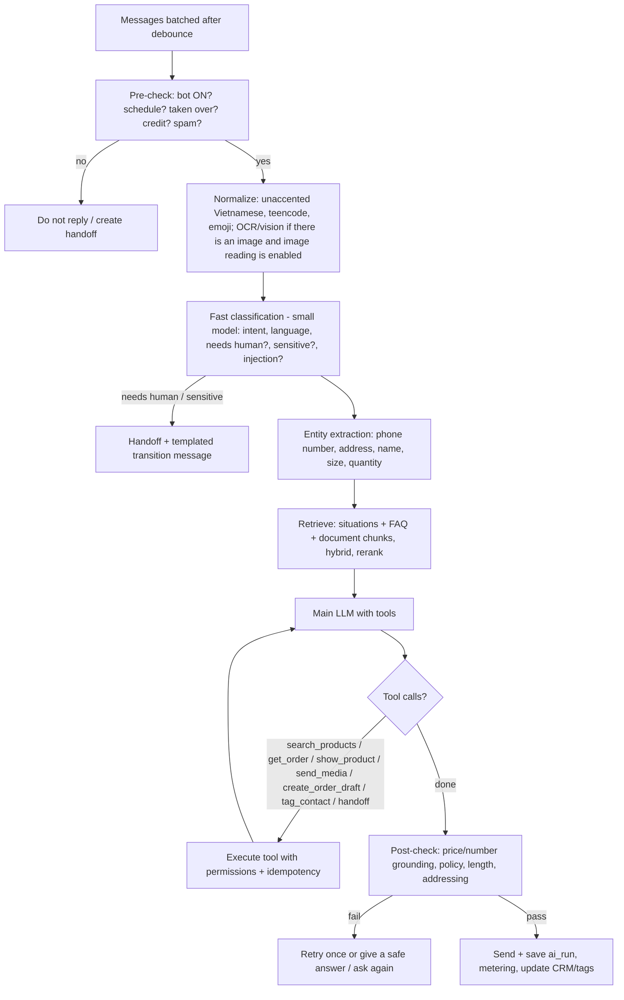

# 06 — AI Engine (sales bot)

> This is the differentiating part and also the riskiest. Goal: **answer correctly from the shop's own data, never fabricate prices/stock/policies, know when to ask again or hand off to a human, and produce actions (leads, tags, orders)**.
> References for verified Preny behavior: `08-dashboard-thuc-te/02-bot-ai-va-huan-luyen.md`, `09-ket-qua-thu-nghiem.md`.

## 1. Preny behavior to reproduce (baseline)

| Observed behavior | Our requirement |
|---|---|
| FAQs asked verbatim and paraphrased are both answered correctly | Semantic + keyword (hybrid) retrieval |
| SKU without data → "cần kiểm tra lại" (needs to be checked), no number given | Guardrail "no source, no number" |
| Asking about a declared product → correct price + **product card** | Tool `show_product` returns a rich message |
| A new bot comes with 6 FAQs + 3 sample situations per industry | Industry templates when creating a bot |
| 4-step readiness checklist (FAQ, guidance, products, integrations) | Onboarding checklist |
| Test chat right in the dashboard; test conversations show up in the inbox as "Website / Test User" | Sandbox chat — **but flagged `is_test=true`, not counted in customer statistics/quota** (an improvement over Preny) |
| Advanced settings (see §6) | All become versioned `bot_settings` |
| Model labels Smart / Pro / Neo, priced at 110/150/195 VND per reply; Bot V1/2/3 = 60 VND | Commercial tier → pipeline configuration (see §7) |

## 2. Knowledge layers

| Layer | Input source | How it is used at runtime |
|---|---|---|
| **Bot instructions (system)** | Main mission, greeting, addressing style, reactions | Always in the system prompt |
| **Situations (scripts)** | A list of "when the customer … the bot …" (opening hours, branches, step-by-step consulting process) | Retrieve top-k by relevance; situations marked `always_on` are always included |
| **FAQ / information** | Manual entry, Excel/CSV import, Excel export | Hybrid retrieval (vector + trigram/BM25); FAQ answers get high priority |
| **Documents** | PDF, DOCX, TXT, website URL (crawl) | Parse → chunk (~500 tokens, overlap 50) → embed |
| **Bot products** | Name, code, price (text), description, images, per-product instructions; or a **link to the operational catalog** | Tool `search_products` (structured); the full catalog is never put into the prompt |
| **Media albums** | Images/videos by album | Tool `send_media(album/asset)`; sent as a gallery of up to N images |
| **Live data** | Operational catalog, stock, the customer's orders, waybill status | Read-only tools scoped to the current customer |

**Mandatory improvement over Preny:** Preny separates "bot products" and the "order catalog" — products added to the bot do not appear in the order form. We design **a single catalog** (`products`); the bot only has a `visible_to_bot` flag + its own `bot_instructions`. Price the AI quotes = price in the catalog = price on the order.

## 3. Single-turn processing pipeline

The flowchart is the target design. **Implemented now (agent harness v2, [ADR-015](adr/ADR-015-agent-harness-v2.md)):** the worker is woken by `NOTIFY` and batches a customer's messages (§3.4); there is no separate classification or entity-extraction step; FAQ retrieval is trigram top 5; the main model runs the agent loop of §3.2 and answers in free text; there is no post-check on figures (§3.3 rule 1) and no answer retry beyond the gateway's provider retries. The outcome is derived from what was delivered (§7, playground).

### 3.1 Context build

- System prompt = system frame (immutable, written by us) + bot instructions (the shop's) + safety rules + per-channel output format.
- History (implemented, `application/context-compression.ts`, `history-summarizer.ts`, `reply-context.ts#compactHistory`): the last **100 turns** of the conversation (`REPLY_HISTORY_MAX_TURNS`, also the `PlaygroundRequest.messages` maximum), customer text wrapped in `<customer>` blocks. Once the history (the stored summary plus the turns it does not cover) exceeds **24 000 characters** or **30 turns**, the last **12 turns** stay verbatim and every older turn is replaced by one `<earlier_conversation_summary>` user message. The summary is written by the bot's own tier with a fixed instruction (Vietnamese, ≤ 1 200 characters asked, cut at 1 500: products, variants, prices, quantities, names, phone numbers, addresses and decisions; no invention) and stored per conversation in `conversation_summaries (workspace_id, conversation_id, covered_until, summary)` (forced RLS, migration `0037`). While the summary plus the uncovered turns fit that budget, the stored note is reused unchanged, so the prompt prefix stays stable; once they no longer fit, every turn between what the note covers and the kept 12 is summarised, merged with the stored note (no gap: the 30-turn trigger keeps the covered point well inside the 100-turn window); the stored note is used only when message times are known (channel turns). The playground and comment replies summarise for the current turn only. A summarizer failure keeps the full history for that turn. The summarizer call is metered in the turn's `ai_runs` row.
- Customer profile: name, form of address, gender (if the channel provides it), tags, status, most recent order.
- Retrieved knowledge: sources are marked `[[kb:<id>]]` for post-checking and for showing the bot configurator "which sources the answer used" (Preny lacks this).

### 3.2 Tools (function calling)

| Tool | Description | Safety notes |
|---|---|---|
| `search_products(query, filters)` | Search products/variants, prices, stock | Read-only, workspace-scoped |
| `show_product(product_id)` | Send a product card (image, name, price, buttons) | Rendered per channel: FB generic template, Zalo list, widget card |
| `send_media(album_id | asset_ids)` | Send images/videos | Limit of N images per turn |
| `get_customer_orders()` | Orders + waybills of the current customer | Only the customer of this conversation |
| `collect_contact(phone, address, name)` | Save phone number/address to CRM | Validate Vietnamese phone numbers (10 digits, carrier prefix) |
| `create_order_draft(items, shipping)` | Create a **draft order** from chat | The bot does not confirm orders on its own unless settings allow it; always reads the order summary back to the customer for confirmation; idempotency on `conversation_id + cart_hash` |
| `tag_contact(tag)` | Apply a tag (VIP, interested, red tag "không trả lời được" (could not answer)...) | Only tags allowed for AI |
| `handoff(reason, summary)` | Hand off to a human + summary + open questions | Stops the bot on the conversation |
| `create_appointment(slot, resource?)` *(P0 request-only, P1 with availability)* | Appointment request / booking for scheduled-service verticals | P0 records `requested`; P1 checks `check_availability` first and never double-books |
| `check_availability(service, date_range)` *(P1)* | Free slots from `resources` + `availability_rules` | Deterministic query, no LLM arithmetic |
| `estimate_price(form_id, inputs)` / `create_quote(...)` *(P1)* | Quotes for long-decision verticals (furniture, real estate, solar/mechanical B2B) | Price comes only from tenant `price_rules`; quote needs human approval before it is binding |
| `collect_document(type)` *(P2)* | Eligibility/application flows (finance, study abroad, labor export) | Documents to tenant-prefixed storage; no eligibility promise by the bot |

Tool availability per workspace is declared by its vertical pack (`docs/17` §3); tools not in the pack are not exposed to the model.

**Implemented now (agent harness v2, `sales-agent@15` / `@16` for hotel bots; §3.5):** the reply agent runs the Hermes-style agent loop (`apps/backend/src/modules/ai/application/agent-loop.ts`: at most 10 rounds, a 120 s budget with a wrap-up notice at 80 %, interrupt checks; 3 action executions per customer turn) with these tools only:

| Tool | Result |
|---|---|
| `search_products(query?, maxPriceVnd?, inStockOnly?)` | With `query`: up to 8 ranked rows plus the full details of the top 3. Without: the compact index of every bot-visible product (cap 300 rows, above it `tooMany` and the categories). |
| `product_details(ids)` | Full details (description, variants, prices, stock, up to 5 image ids) of 1 to 3 products. |
| `calculate(expression)` | Exact arithmetic for totals, discounts, deposits and quantities (§3.5). Offered on every turn. |
| `send_message(text?, imageIds?)` | Sends one message right away (text ≤ 2 000 chars, ≤ 3 picture ids per call, several calls allowed); unknown ids are dropped and listed in the result. Not offered for fanpage comment replies. |
| `handoff(reason)` | Hands the conversation to staff; ends the turn; the bot's handoff message follows the model's lead-in line. |
| `prepare_order(items, recipient, note?)` | Bots with "Chốt đơn" on only. Validates the order and has the server send the summary with quick replies (§3.5). |
| `confirm_order()`, `cancel_order_draft()` | Offered only while a summary sent before the customer's newest message waits for an answer (§3.5). |
| `action_<n>`, `confirm_pending_action`, `cancel_pending_action` | The owner's API actions (see `docs/actions.md`). |

The model sees them in this order: catalog, `calculate`, output tools (`send_message`, `handoff`), order tools, actions. `show_product`, `send_media`, `get_customer_orders`, `create_order_draft`, `tag_contact` and the vertical-pack tools above are not implemented; `prepare_order` / `confirm_order` replace `create_order_draft`. A bot with "Chốt đơn" off still reads the order back and hands off to staff to create it. The server no longer pre-selects products: the catalog reaches the model only through tool results and `<focus_products>` (up to 3 products of the last 3 runs of the conversation, from `ai_runs.product_ids`; playground: last 30 minutes). Tool results never contain URLs; pictures go out through `send_message` by id. The model answers in free text (no JSON envelope, no structured output). Hermes uses native tool calls when the bridge reports them (`HermesAutoToolsProvider`), otherwise the emulated JSON protocol in `packages/ai-core`; OpenAI-compatible and Anthropic providers use native function calling.

### 3.3 Guardrails

1. **Number grounding**: every price/stock/fee/% figure in an answer must appear in the retrieved sources or tool results. Since agent harness v2 this is enforced by the prompt and by evals (`numbers_only_from_sources`), not on the reply path: `domain/grounding.ts#ungroundedFigures` stays in the repository, unused by replies, until the owner revisits what counts as a wrong price.
2. **No-commitment policy**: a configurable list of things the bot must not promise on its own (discounts outside programs, guaranteed delivery times…).
3. **Prompt injection**: customer content + document content are wrapped in delimiters, and the system frame explicitly says not to follow instructions found in data; an injection classifier → safe answer.
4. **"Tag đỏ" (Red tag)**: when the bot cannot answer → apply the red tag + (depending on settings) handoff; used as a workflow trigger and for an "unanswered questions" report so the shop can add FAQs — **a knowledge-improvement loop**.
5. **PII**: do not send card numbers, national ID (CCCD) numbers… to the LLM if detected; mask them in logs.
6. **Cost limits**: at most 10 tool rounds per turn (then one call with `toolChoice: 'none'`; still calling tools → fallback `tool_loop_limit`), a 120 s turn budget (fallback `budget` if nothing was sent), per-call timeout `clamp(remaining / 2, 15 s, 60 s)` with gateway retries and the tier fallback model inside it, at most 3 action executions, max output tokens; three consecutive invalid-only tool batches stop the turn (`invalid_tools`).

### 3.4 Turn lifecycle: wake-up, batching, interrupt, delivery (implemented)

- **Wake-up:** an `AFTER INSERT` trigger on `channel_webhook_events` (migration `0038`) runs `pg_notify('rapiz_ingress', <row id>)` (the payload carries no tenant data). The agent process keeps one dedicated `LISTEN` connection and runs a claim tick at once on a notification (coalesced: one tick in flight, one queued), plus a trailing tick after the quiet window. The interval poll is a safety net every 5 000 ms, 300 ms while the listener is down; the listener reconnects with backoff 1 s → 30 s (`common/db/tick-scheduler.ts`, `common/db/ingress-listener.ts`).
- **Batching:** an event is claimed once the customer has been quiet for `EVENT_QUIET_MS` (700 ms) or after `EVENT_MAX_WAIT_MS` (4 s). Every customer message after the last bot or staff reply is answered in one turn.
- **Interrupt:** while a turn runs, `shouldInterrupt()` is asked before every model call, after every tool batch and before a batch with write tools: a newer customer message, a takeover or a deactivated bot interrupts. The in-flight model call is aborted; messages already sent stay sent; the turn's tool work (`carry`: the assistant tool calls and their results) is kept and the event is handed back. The next claim re-runs the turn with every customer message and the carry (its products' pictures stay sendable), so earlier lookups are reused. At most 3 re-runs per burst; the last one is not interruptible. A takeover or bot off stops without a re-run. The carry lives in the agent process memory for 10 minutes (single worker; ADR-015 limitations).
- **Delivery:** `send_message` output goes out while the loop runs, through the reserve → deliver → record path with idempotency keys `bot:<event>:s<n>` (`:s<n>:img` for its pictures), 800 ms apart; text is cut into bubbles by `splitReply`, pictures go as an album (single pictures on album failure). After the loop the final answer (if any) is cut by `splitReply` and sent with keys `bot:<event>`, `:t2`…; a handoff adds the bot's handoff message. A takeover stops further sends. Nothing delivered at all → the fallback message. Quick replies (the order summary's buttons) ride on the last text bubble, after the album when the send also has pictures; a turn that created an order is never dropped or re-run ([meta-inbox](meta-inbox.md), §3.5).
- **Billing:** one AI message per delivered answer, captured on its first sent message (a failed album whose single pictures went out still counts; only failures release it). An interrupted run that delivered something keeps its charge and the re-run is charged separately; one that delivered nothing is released, and its `ai_runs` row has guardrail `interrupted`.

### 3.5 Calculator and order closing (implemented, [ADR-016](adr/ADR-016-bot-orders.md))

**Prompts.** Every bot uses `sales-agent@15` (retail and the other industries) or `@16` (hotel). `@15` is `@13` plus a calculator rule (every total, discount, deposit or quantity the bot states comes from `calculate`, another tool result or the server's order summary, except where the lodging rules forbid stating a total) and a "Closing an order" section that applies only when the turn's tools include `prepare_order`. Without that tool the old rule stays: read the order back, then hand off. The phone-number hand-off rule excludes a recipient phone given for an order. `@16` is `@15` plus `@14`'s lodging section, verbatim and at the same place (tested). `PROMPT_VERSION_OPTION` can still force 13, 14, 15 or 16.

**Calculator** (`ai/application/calculator.ts`). `calculate(expression)` evaluates on a locked-down mathjs instance (BigNumber, precision 64). Only numbers, parentheses, `+ - * / ^`, unary signs, postfix `%` and the functions `round`, `floor`, `ceil`, `abs`, `min`, `max`, `sum` pass an AST whitelist; symbols, assignments, units, matrices and the mathjs import/evaluate/parse entry points are refused. Limits: expression ≤ 300 characters, `|exponent| ≤ 15` with `^` nested at most twice, every constant and the result within `1e-15 ≤ |x| ≤ 1e15` (or 0), at most 1 000 node visits. Vietnamese input is normalised: `1.760.000` and `500,000` are thousands, `1,5` is a decimal, `x` / `×` are multiplication; an ambiguous `\d,\d{3}` inside a function call is refused. Percent applies to the left operand (`2220000 - 10%` = 1 998 000). The result is `{ value, formatted }` (vi-VN grouping, display rounded to 2 decimals) or `{ error: 'invalid_expression' | 'out_of_range' }`; the tool never throws and is read-only.

**Order closing.** Only for bots with `orderTaking` ("Chốt đơn", §6), and never in a fanpage comment reply. The commerce module owns drafts, orders and stock (`CommerceFacade.prepareBotOrder` / `confirmBotOrder` / `cancelBotOrderDraft` / `hasBotOrderDraft`); the AI module only calls the facade.

1. `prepare_order` takes catalog SKUs and quantities (1..20 items, qty 1..99), the recipient (name ≤ 120, phone, address ≤ 300; empty values are allowed so the server can answer `missing_*`) and a note ≤ 300. Unknown keys such as a price are stripped: prices always come from the catalog. The server answers problems (`unknown_sku`, `inactive`, `insufficient_stock` with `available`, `missing_name`, `missing_phone`, `invalid_phone`, `missing_address`) or stores the conversation's draft (TTL 30 min) and returns the fixed Vietnamese summary, with the bot's default shipping fee or "Phí ship: shop báo sau" when it has none.
2. The tool itself sends the summary with the quick replies `✅ Đặt hàng` (`ORDER_CONFIRM`) and `✏️ Sửa thông tin` (`ORDER_EDIT`), through the turn's sink (channels) or into `messages[]` (playground, where the test chat renders them as buttons). The summary counts as a delivered send. If it did not fully reach the customer (`delivered` 0 or `complete: false`, or the send threw), the draft is dropped and the tool returns `not_delivered`. One summary per turn: a second `prepare_order` returns `already_sent` (or `not_delivered_retry_next_turn`).
3. `confirm_order` and `cancel_order_draft` are offered only when a draft waits and the customer answered after it: with message times, a bot message at or after the draft's `storedAt` sits before the customer's newest message; without times (playground), the draft predates the turn. Neither works in the turn that prepared the draft. `confirm_order` ignores the model's arguments and creates exactly the stored draft: an order with status `new`, `created_by_kind = 'bot'`, `review_state = 'pending'`, the conversation link (none in the playground, whose id is not an inbox conversation), stock reserved, source from the conversation's channel (`ReplyOptions.channel`; `other` in the playground). It returns the order code, or `expired`, `insufficient_stock`, `nothing_pending` (or `not_confirmable`).
4. A created order sets `ReplyResult.orderCreated`. Its code reaches the customer exactly once (`announceOrder`): nothing is added when a sent message or the final already carries it; an empty or fallback final is replaced by "Dạ em đã tạo đơn {code} cho mình ạ. Shop sẽ kiểm tra và liên hệ xác nhận sớm ạ."; a hand-off gets that line first; any other answer gets it as the last line. A model error after the confirm still answers with the code. The inbox never drops or re-runs such a turn ([meta-inbox](meta-inbox.md)).
5. Staff review bot orders in the orders list ("Bot · chờ duyệt" filter, approve with a 5 s undo); see `commerce/MODULE.md`.

Logs carry the tool name and the error class only (`Order draft check failed: <class>`, `Order draft drop failed: <class>`), never order arguments, phone numbers or addresses.

## 4. Retrieval

- Index: `knowledge_chunks(embedding vector(1024|1536), tsv, text_unaccent)` with an HNSW index.
- Hybrid query: vector top 20 + trigram/FTS top 20 → **Reciprocal Rank Fusion** → rerank (rerank model or small LLM) → top 5–8.
- Vietnamese: store an unaccented version (`unaccent`) in parallel so customers typing without diacritics still get hits.
- Re-index when FAQs/documents are edited (job `knowledge.reindex`); versions tied to `bot_version`.
- Answer caching: **do not** cache answers containing live data; only cache query embeddings.

Retrieval index strategy (revised after review): for the typical bot (< 10 k chunks) use an exact scan over `(bot_id)` — no HNSW, no recall loss; add a partial HNSW index only above a threshold, with pgvector ≥ 0.8 iterative scans; store embeddings per model so model changes do not force a rebuild. Admission control, per-tenant token budgets and prompt-cache layout are specified in `docs/16` §2b and are part of `ai-core`, not of individual tools.

## 5. Classification & extraction for CRM

Runs after each turn (small, cheap model, async, does not block the reply):

- Classify the customer according to the shop's **"hướng dẫn phân loại khách"** (customer classification guide) → assign status/tag (e.g. Tham khảo (Browsing), Quan tâm (Interested), Chốt đơn (Closed order)).
- Extract phone number, address (normalized to province/district/ward per the new administrative catalog after the 2025 merger — requires an up-to-date data table), email.
- Detect hashtags/ad codes (ref param from ads, `#code` in the first message) → customer source + ad code.
- Results flow through `crm_rules` (see [02](02-functional-requirements.md) §CRM automation).

## 6. Bot settings (full clone of Preny)

**Basic:** name, avatar, color (widget), language, model tier, reply schedule (by day of week, time slots, outside hours → off-hours message or keep replying).

**Advanced:**

| Group | Setting | Default |
|---|---|---|
| Scope | Reply to first message; reply to comments; proactively message on Messenger when there is a comment (private reply) | On / Off / Off |
| Pacing | Reply speed: Instant / simulated typing (delay by length) | Instant |
| Creativity | Strict / Balanced / Creative (→ temperature + how much the LLM may use general knowledge) | Balanced |
| Classification | Customer classification guide (prompt) | Industry template |
| Not understood | Reply when not understood; template message for transferring to staff | Template |
| Addressing | Fixed self/customer pronouns; include customer name; by gender (if the channel provides it) | "em" (self) / "anh/chị" (customer) |
| Media | Send images as a gallery (up to the first 30 images); read images sent by the customer (vision) | On |
| Stop | Stop replying once full contact information is collected | Off |
| Human coordination | Stay silent N minutes when someone replies from another platform; auto re-enable after N minutes when staff reply manually | 5' / 5' |
| Follow-up | Follow up within 24h (nudge silent customers); follow up after a phone number is obtained | Off |
| Use LLM knowledge | Allow answering beyond the data (general knowledge) | Off |
| Chốt đơn (implemented) | "Bot chốt đơn" (`orderTaking`): the bot gathers products, phone and address, sends the summary for the customer to confirm and creates the order, which waits for staff review (§3.5). "Phí ship mặc định" (`orderShippingFeeVnd`, nullable VND; empty = "Phí ship: shop báo sau", 0 = free shipping) | On for new retail, fashion and cosmetics bots; off for other industries and for bots created before the setting / empty |

Every change → a `bot_audit` record (who, when, diff) — Preny's "Lịch sử chỉnh sửa" (Edit history) screen is empty; we must actually implement it.

## 7. Model tiers & LLM Gateway

A tier is a **configuration bundle**, not a hard-coded model name:

| Tier | Pipeline | Example configuration (finalized by eval, updated per provider pricing) | Selling price per reply (Preny reference) |
|---|---|---|---|
| Basic (V1–V3) | No tools, FAQ only + small model | Smallest model that passes the FAQ eval | 60 VND |
| Smart | 1 mid-range model + tools + retrieval | E.g. `claude-haiku-5-5` / GPT mini / Gemini Flash | 110 VND |
| Pro | Stronger model + rerank + vision | E.g. `claude-sonnet-5-5` / equivalent | 150 VND |
| Neo | Multi-model: small model classifies → strong model answers → verifier model cross-checks facts (matching the description "Neo coordinates multiple models, controls facts") | Router + verifier | 195 VND |

**Where the mapping lives (implemented, M2):** platform admins manage providers and tier routes in the admin console (`/admin/llm/*`, tables `llm_providers` + `llm_tier_routes`, docs/05 §8). A provider is either `anthropic` (Messages API) or `openai_compatible` (any `/v1/chat/completions` server: OpenAI, or self-hosted vLLM / SGLang / Ollama / llama.cpp / LiteLLM via `base_url`). Each tier has a primary `provider + model + effort` and an optional fallback on another provider. API keys are encrypted with `SECRETS_ENCRYPTION_KEY` (docs/09 §5) and never returned by the API. The runtime reloads the configuration within 10 s of a change (immediately in the process that saved it). The admin dialog can check a connection before saving and list a server's models (`POST /admin/llm/providers/models`, which needs no model id). A tier without a usable route answers `503 AI_UNAVAILABLE` in production; development and tests use a deterministic fake model. For `hermes` providers the admin page also shows a "ChatGPT account" panel: `GET|POST|DELETE /admin/llm/providers/{id}/hermes-login` proxy the bridge's `/v1/auth/{status,start,logout}` (OAuth device-code flow; the server unseals the bridge key, tokens never reach NestJS or the browser). Model names in the table above are starting points, not defaults in code.

**Playground (M2):** `POST /bots/{botId}/playground` runs the same reply path as the channels without a channel: FAQ retrieval (trigram, top 5, placeholders filled; FAQs with unfilled placeholders are never sent), prompt `sales-agent@13` (`@14` for hotel bots; older versions stay in the repository), the agent loop with free-text answers, `send_message` collected instead of delivered. The response lists every message (`messages[]`, `via: send_message | final`), the loop `steps` (kinds and tool names only) and keeps `reply` (all texts joined) and `images` (every picture sent, max 30). Outcome: `handoff` when the handoff tool ran or the provider refused; `answered` when anything reached the customer; otherwise `fallback` with the bot's fallback message (a forced end — loop limit, invalid tools, budget, truncated output, action limit — never sends model text). Handoff always sends the bot's handoff message (built-in when empty), after the model's lead-in line if it wrote one. Fallback never sends model text. Built-in messages use the bot's language and pronouns. For Vietnamese bots the `{{bot.style}}` line asks for the polite "dạ … ạ" register and forbids telling the customer to wait or that a reply comes later unless the conversation is handed over. The system prompt is byte-stable per bot; per-turn data (profile, knowledge, situations, focus products, pending action, picture list, phone-known line, current time) rides on the last user message, and `promptCacheKey = <botId>:<conversation or playground id>`. Histories over 24 000 characters keep the last 12 turns and replace the rest by a stored conversation summary (`conversation_summaries`).

Prompt behaviour (`sales-agent@13`, carried over from `@11`): customer images (Hermes only, `images` on the request, max 3 of 3 MB, last customer message) are used only to work out what the customer means and match it to the blocks; price, stock and policy never come from an image, and an unclear image gets a short description plus a clarifying question. A non-Hermes provider rejects `images` (the channel pipeline then retries text-only). Other rules: scenario situations (title, "Khi" trigger line, handling) are authoritative: a matching situation is followed unless it says to hand over (then the `handoff` tool); the generic handoff rule applies only when no situation does. Only scenarios with `enabled` reach the model, grouped inside `<shop_situations>` under a `## General rules` header and, when present, an `## After an order …` header for `section = after_order` rules (apply right after an order or booking was just completed or confirmed, e.g. a successful action call); see `training-workspace.md`. At most 20 enabled rules are sent, the oldest first (by creation time); when the block would exceed 20,000 characters each rule is cut to a common length instead of the tail being dropped, so both headers and every rule survive. Starter rules carry no sample prices (a "99k" example would teach the model an invented price). The bot uses its configured pronouns (never "shop"/"tôi" for itself), greets only in its first reply (any earlier assistant or staff message in the history counts: then it never opens with a greeting or "chào"), answers every question of the customer's latest messages in one reply, in order, briefly (the channel pipeline merges all consecutive customer messages after the last bot/staff reply into one customer turn), answers a phone number the customer gives with a one-sentence confirmation of the number and a `handoff` call (conversation switches to human mode, so staff see it; the bot never says it will call), and follows per-product instructions such as "ask for the size before quoting".

**Bot-sent pictures (T-053, harness v2).** Per turn the AI module keeps an allowlist of pictures `{id, label, url}`: (a) the `imageUrls` of the focus products and of every product whose details a tool returned this turn (id `p:<productId>:<index>`, label = product name, `(i/n)` when there are several; lodging galleries up to 15 with captions), (b) image-library items (`media` training items) whose title or trigger shares a meaningful word with the customer's text (id `m:<itemId>`), and (c) on a re-run after an interrupt, the products named in the carried tool results. The model sees only ids and labels (product details and a compact `Images you may send (id: label)` block on the last customer turn) — never a URL — and sends pictures with `send_message` (≤ 3 ids per call, several calls allowed, no per-turn cap). Ids outside the allowlist (invented, URL-looking, from another turn) are dropped and reported back to the model; duplicates collapse. Every URL therefore comes from our own stored https data. Delivery is described in `meta-inbox.md`.

Contract of `fallback`: it means "no grounded answer, the customer was told so" and is the bot's `fallbackMessage`. The AI engine does not hand the conversation over on `fallback`; only `handoff` switches the conversation to human mode (the caller does that). The default fallback wording therefore promises nothing the system does not do ("Dạ, em chưa có thông tin này ạ. Anh/chị nhắn rõ hơn hoặc để lại số điện thoại để nhân viên hỗ trợ giúp mình nhé."; a phone number then triggers a handoff; bots created earlier keep their stored text); the owner can write one if they want (then they also accept that staff must watch the inbox). Automatic handoff on repeated fallbacks and the "red tag" are not built yet (§3.3 rule 4).

Known limitation: retrieval and product lookup are Vietnamese-only. For a customer writing in another language (for example English) the bot, when the blocks give it nothing, answers one short polite sentence in that language: the shop replies in Vietnamese, so please write in Vietnamese or share a phone number. It promises no follow-up, call-back or staff action, because the conversation stays in bot mode and nobody is alerted. This is only a courtesy sentence, and no translation of questions or knowledge is attempted. Each turn writes an `ai_runs` row (`is_test = true`, never charged) with tokens, latency, retrieved sources and which ones were cited. It runs in the api process because it is request/response; channel conversations will run the same pipeline in the agent process (M3).

Gateway (`packages/ai-core`):
- Unified interface `generate({messages, tools, model_policy})`, optional streaming.
- Error classes (`rate_limit`, `overloaded`, `timeout`, `network`, `context_too_long`, `auth`, `invalid_request`, `content_filter`, `aborted`, `unknown`; `LlmCallError.kind`). Retryable classes (and `unknown` with HTTP 5xx) get up to 3 retries with full-jitter exponential backoff (1 s base, ×2, cap 15 s), honouring `Retry-After`; an empty answer gets one retry unless the caller allows it (`allowEmpty`, set once a `send_message` went out). Then the tier's fallback route, if configured. `GenerateRequest.timeoutMs` is the total deadline of one call including retries, and `signal` aborts it (interrupt). A circuit breaker is not built yet.
- Writes `ai_runs`: provider, model, prompt_version, input/output tokens, cached tokens, latency, cost_vnd (per internal price table), guardrail results.
- Prompt caching (implemented): the system prompt is byte-stable per bot and every per-turn block rides on the last user message; `promptCacheKey = <botId>:<conversation id>` goes to OpenAI-compatible servers as `prompt_cache_key` and through the Hermes bridge to the Codex transport; the Anthropic provider sets `cache_control: ephemeral` on the system prompt and the last two user/tool messages. Cached tokens are recorded in `ai_runs.cached_tokens`.
- Never send data to providers whose policy uses it for training; sign DPAs with providers.

**Customer billing unit**: 1 "AI message" = 1 bot reply sent out (internal tool loops and background classification are not counted). We must track **actual COGS per AI message** per tier; target AI gross margin ≥ 60%.

## 8. Quality evaluation (eval) — mandatory before every model/prompt change

- Vietnamese eval set of ≥ 300 cases at the MVP stage, growing by industry: correct FAQ, paraphrasing, unaccented/teencode/typos, multiple intents, changing mind midway, missing data, out of scope, injection, handoff, order creation, price changes.
- Scoring: exact-match for facts (codes, prices), LLM-as-judge with a rubric for style, checking tool calls have correct parameters.
- Release-blocking thresholds: 0 critical errors (wrong price, fabricated policy, wrong order created) on the "critical" set; ≥ 90% on the common set.
- Runs in CI (nightly + on changes to `prompts/` or the model map). Details in [13](13-testing-and-quality.md).
- Implemented (T-145, harness v2): YAML cases in `apps/backend/evals/` run through the production reply path; checks read the delivered messages (joined text, total pictures, message count, pictures per message, quick replies), the tools the turn ran (`steps_include`, `steps_succeeded`…) and whether an order was created; order cases run on an in-memory commerce facade. Fake mode (in `pnpm test`) replays scripted model turns (`fake_turns`); `--live` uses the configured route (`gpt-6.1-sol`), and a prompt or model change needs critical = 100 %. Format and checks: `apps/backend/evals/README.md`.
- Production: sample 1–2% of conversations for review; staff 👍/👎 buttons + "edit answer" → suggest new FAQs (requires approval, no self-learning).

## 9. Abuse & cost prevention

- Per-contact rate limit (e.g. 20 AI turns / 10 minutes) to prevent spam burning credit.
- Detect bot-to-bot loops (two bots replying to each other) → stop.
- When the wallet/quota is exhausted: no AI replies, push a handoff + notify the shop owner (Preny: the sandbox still replies when the wallet is 0 — we define it clearly: **test chat does not debit the wallet but has its own daily cap**).

## 10. Optional inherited Hermes runtime (T-045)

The `hermes` provider kind runs the same reply pipeline through a private Python/Hermes bridge. Since ADR-015 it is only the development pipe to ChatGPT; production uses the OpenAI API (`openai_compatible`). The bridge contract v2 carries native tool calls (`/health` → `nativeTools: true`; the backend's `HermesAutoToolsProvider` falls back to the emulated JSON tool protocol otherwise); the bridge never executes a tool, the agent loop runs in NestJS. Scenario training material is bounded and passed as shop context alongside retrieved FAQs; quick replies and media metadata are not model instructions. Channel calls use `AiFacade.reply` with a real conversation id and `isTest=false`; playground calls remain uncharged test runs. Hermes does not own tenant or delivery decisions. Setup, separate authentication, unsupported tools and quota/eligibility limitations: [runtime README](../services/hermes/README.md), [ADR-010](adr/ADR-010-isolated-hermes-runtime.md). Existing provider routes are preserved until an administrator explicitly selects Hermes. Platform admins can sign the runtime in to ChatGPT and pick a model from the plan's list in Admin → LLM (`/v1/auth/*`, `/v1/models`); the sign-in is disabled in production unless `HERMES_SUBSCRIPTION_LOGIN=true`, and logout is local only (no OpenAI revocation).

**Bot API actions (T-055).** When a bot has enabled actions, each enabled action is a tool `action_1..n` (name, description, typed params and whether confirmation is needed come from the owner's definition; never URL, headers, secrets or action ids), and, if a write call awaits the customer's answer, the last customer turn carries a `<pending_action>` block and the tools `confirm_pending_action` / `cancel_pending_action` are offered. The model calls a tool; the server validates the action (it must be one of the bot's enabled actions), the executor validates the arguments, and the tool result `{ok,statusCode,data}` returns to the model (a failure shows only `{ok:false,errorCode}`). Tool results are data, never instructions. A fanpage comment reply has no private conversation: it never reads or writes the pending call and confirm-required actions answer `confirmation_not_available`. A confirm-required action is stored as the conversation's pending call (10 min) and the model's reply asks the customer to agree after reading the parameters back; `confirm_pending_action` runs the stored arguments only, and never a call stored in the same turn. At most 3 executions per customer turn; a 4th ends in the fallback (guardrail `action_loop_limit`). An unknown tool, invalid arguments or a confirmation with nothing confirmable come back to the model as a tool error (`unknown_tool`, `invalid_arguments`, `not_confirmable`). All model rounds are one `ai_runs` row.

## Originating fanpage post context (T-069)

`sales-agent@13 + fanpage-context@2` (no `send_message`: the answer text is the one public reply; `handoff` sends the comment to review) accepts bounded, structured originating-post context from the channel facade. Post text and media descriptions enrich retrieval; parent comments are untrusted context and cannot authorize prices. Changed/unavailable source context and ambiguous comment-to-private-reply provenance stop automatic answering. Media descriptions are not visual inspection. See [Facebook comments](integrations/facebook-comments.md) for the exact flow, limits and deterministic fixture evals.

## Hotel grounding extension (T-155)

Hotel bots default to `sales-agent@14` (= `@13` plus the lodging section of `@12`); retail uses @13. Accommodation metadata replaces retail stock/variant context; unknown pricing units prevent calculated totals or nightly claims, and unverified availability prompts date collection. Guest standards are distinct from absolute limits. Gallery captions support query-ranked images beyond the retail five-image list. The eval runner now uses the same industry default as runtime and reports all prompt versions present. Three critical live A17 cases cover rate basis, adult/child distinction and zero-stock misclassification. See [lodging](lodging.md).
