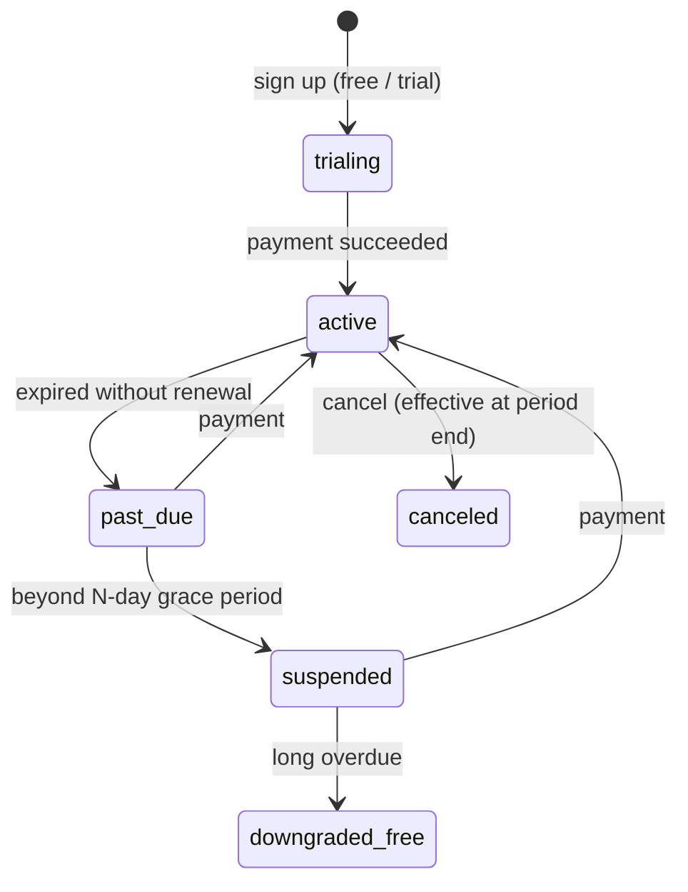

# 08 — Plans, quota, credit & payments

> References: `01-business-model/02-gia-va-doanh-thu.md`, `08-dashboard-thuc-te/07-gia-credit-han-muc.md`, `06-khao-sat-tung-page/01-noi-dung-tuong-tac.md`.
> The prices below are **Preny's prices as of 23/10/2026, for reference only**; our prices are decided by the business — the system must be fully configurable from the back-office, **no hard-coding**.

## 1. Three revenue streams (same as Preny)

1. **Subscription** by plan (capacity: number of channels, number of staff, CRM contacts, storage, media, model tier, unlocked features).
2. **AI message wallet** — pay per response, unit price by model tier; purchased credit never expires.
3. **ZBS/ZNS wallet** (and later SMS/email) — sending remarketing messages, VAT included, charged only on successful delivery.
4. (Addition) **Implementation / script optimization services** — sold as a one-time add-on.

## 2. Reference plan table (Preny)

| Plan | Price/month 3M · 6M · 12M | Channels | Staff | CRM contacts | Storage | Images/Videos | Model | Included AI messages |
|---|---|---:|---:|---:|---:|---:|---|---|
| "Miễn phí" (Free) | 0 | 3 pages | 1 | 5,000 | 0 GB | 10 | Smart (in practice) | 1,000 messages / 14 days |
| Sales Smart | 1,310,000 · 1,050,000 · 785,000 | 5 | 5 | 20,000 | 10 GB | 200 | Smart | 7,000/month (promotion) |
| Sales Pro | 1,624,000 · 1,299,000 · 974,000 | 20 | 15 | 50,000 | 30 GB | 200 | Pro, Pro special | 7,000/month (promotion) |
| Sales Neo | 2,499,000 · 1,999,000 · 1,624,000 | 100 | 30 | Unlimited | 100 GB | 600 | Neo, Neo special | 7,000/month (promotion) + 1-on-1 script support |
| Enterprise *(our addition)* | Contact us | Custom | Custom | Custom | Custom | Custom | Custom + SLA, SSO, API | Contract |

Locked on Free: website widget, Lazada, Facebook posts, (email campaigns require phone number verification). Free training data quota: 500 items.

AI wallet unit prices: Basic (V1–V3) 60 VND · Smart 110 VND · Pro 150 VND · Neo 195 VND / response.

## 3. Entitlement model

```
plans (code, name, billing_periods[], price_by_period, is_public, version)
  └─ plan_entitlements (plan_id, key, value_type, value)   ← example keys:
       channels.max = 5
       members.max = 5
       contacts.max = 20000
       storage.bytes = 10GB
       media.max = 200
       knowledge_items.max = 500
       ai.models.allowed = ["smart"]
       ai.included_messages = { amount: 7000, period: "month" }
       feature.website_widget = true
       feature.lazada = false
       feature.email_campaign = true
       feature.workflow = true
       feature.api_access = false
subscriptions (workspace_id, plan_id, plan_version, period, status, current_period_start/end, cancel_at, trial_end)
workspace_entitlement_overrides (workspace_id, key, value, reason, expires_at)  ← add-on sales, promotions, Enterprise
```

- **Entitlement service** computes the effective value = plan ⊕ overrides ⊕ add-ons; cached in Redis for 60s, invalidated when the subscription changes.
- **Guards** at the API: `@RequiresFeature('website_widget')`, `@ConsumesQuota('contacts')`.
- The UI reads `GET /me/entitlements` to lock/unlock buttons and show the "Upgrade" screen in the right context (Preny does this well: it blocks exactly when the user wants to start operating for real).

## 4. Quota & counters

| Type | How it is counted | Reset |
|---|---|---|
| Stock counters (contacts, members, channels, media, knowledge_items, storage) | Actual `COUNT`/SUM, cached in `usage_counters`, reconciled periodically | No reset |
| Period counters (AI messages included in the plan) | `usage_counters(workspace, key, period_start)` incremented in the same transaction as `ai_runs` | Per subscription cycle (free: 14 days) |

The "Hạn mức sử dụng" (Usage limits) screen shows: training data, members, AI messages (+ reset date), pages, images, CRM contacts, storage.

Behavior when hitting quota: warnings at 80% and 100% (in-app + email); exceeding the plan's included AI messages → deduct from the AI wallet; wallet = 0 → the bot stops AI replies, switches to handoff, red banner. **Never leave the end customer waiting indefinitely** — send a "staff will reply soon" message (configurable).

## 5. Wallets & ledger (simple double-entry)

```
wallets (id, workspace_id, type: 'ai' | 'zbs' | 'email' | 'sms', balance_minor BIGINT, held_minor BIGINT, currency)
ledger_entries (id, wallet_id, workspace_id, kind: 'topup'|'debit'|'hold'|'capture'|'release'|'refund'|'grant'|'adjust',
                amount_minor, balance_after, ref_type, ref_id, idempotency_key UNIQUE, created_by, created_at, meta JSONB)
```

- Internal unit: **dong × 1000 (milli-dong)** or "credit" at a fixed ratio; Preny displays 110 VND = 0.11 credit → 1 credit = 1,000 VND. Store integers, no floats.
- Wallet debit: `UPDATE wallets SET balance = balance - :x WHERE id=:id AND balance >= :x RETURNING` + insert the ledger entry in the same transaction; idempotency_key = `ai_run:{id}` → no double charges when a worker retries.
- ZBS campaigns: **hold** the total estimated cost when scheduling → **capture** each successful message → **release** the failed/canceled portion.
- Nightly reconciliation job: `balance == SUM(ledger)` for every wallet; mismatch → alert.
- Top-up history / usage history (2 separate tabs per wallet, as in Preny) = ledger queries filtered by kind.

## 6. Payments & subscription lifecycle



- Periods: 1/3/6/12 months (Preny publicly lists 3/6/12; its policy mentions 1 month).
- Mid-period upgrade: **prorate** the remaining value of the old plan and credit it against the new plan; downgrade: effective next period. Preny: no refunds — include in the ToS.
- When `suspended`: the bot stops replying, data is kept intact, read-only; when downgraded to free while exceeding stock quotas (e.g. 20,000 contacts > 5,000): **do not delete**, block new additions.
- Payments: VNPAY, VietQR bank transfer with auto-matching, (P2) MoMo; **vouchers** (percentage discount, fixed amount, bonus credit, bonus days) with an expiry date, usage limit, and applicable plans.
- Invoices: store `invoices` + invoicing details (company name, tax ID, address, email) in "Thông tin workspace" (Workspace information); e-invoice (HĐĐT) integration (P1).
- Plan purchase transaction history: `payments` + `invoices` tables.

## 7. Affiliate

- Terms must be accepted (store version + timestamp) before entering the module.
- Referral links (`?ref=CODE`, 30–90 day cookie, last-click), manage multiple links + UTM.
- Commission: % per order (Preny UI 20%; public page up to 35% / fixed bonus of 300,000 VND) → **configurable rules** by campaign, audience, plan period.
- Commission states: `pending` (waiting for the reconciliation window to expire) → `approved` → `paid` / `reversed` (on refund/cancellation).
- Withdrawal: minimum of N customers (Preny: from 3 customers), bank details (encrypted), admin approves the payout.
- Reports: referred customers, clicks, sign-ups, paid conversions, commissions.

## 8. Back-office required from the MVP

- Create/edit plans, entitlements, per-period prices (versioned — existing subscriptions keep their old version).
- Grant credit / extend / override entitlements for a workspace (reason mandatory, audited).
- Approve bank transfers that did not auto-match; manual refunds.
- Reports on MRR, ARR, number of paying workspaces per plan, wallet revenue, **AI COGS by tier** (from `ai_runs.cost`), margin.
