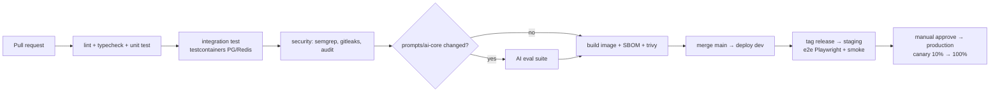

# 10 — Infrastructure, deployment & operations

## 1. Environments

| Environment | Purpose | Data | Real channels |
|---|---|---|---|
| `local` | Development on the machine (docker compose: postgres, redis, object-storage (SeaweedFS), mailpit, langfuse) | Seed | No — use webhook fixture replay + ngrok/cloudflared when needed |
| `dev` | Continuous integration on every merge into `main` | Seed + fake data | Internal test Page/OA |
| `staging` | Acceptance, AI eval, load testing, Meta App Review testing | Anonymized copy | Test Page/OA |
| `production` | Customers | Real | Real |

Configuration via environment variables + secret manager; the env schema is validated with Zod at startup (the app will not run if anything is missing). Product configuration that operators change at runtime — LLM providers and tier routing — is **not** env: it lives in the database and is edited by platform admins (docs/06 §7). The agent worker wakes on Postgres `LISTEN/NOTIFY` (channel `rapiz_ingress`, fired by a trigger on `channel_webhook_events`) and keeps a 5 s safety poll (300 ms while the listener is down; reconnect backoff 1 s to 30 s). The listener needs a direct, non-PgBouncer connection: `DATABASE_LISTEN_URL` (optional, defaults to `DATABASE_SYSTEM_URL`). First admin per environment: `pnpm --filter @agent-sales/backend platform-admin grant <email>` with `DATABASE_SYSTEM_URL`.

**Local object storage.** `infra/docker/docker-compose.local.yml` runs `object-storage` (SeaweedFS, S3 API on `localhost:9000`; MinIO community images are no longer pullable). `infra/docker/seaweedfs-s3.json` defines the `rapiz` identity (the `S3_ACCESS_KEY`/`S3_SECRET_KEY` from `.env.example`) and an `anonymous` identity with `Read` only, so objects are publicly readable by URL but not listable. Create the bucket once: `docker compose -f infra/docker/docker-compose.local.yml exec object-storage sh -c 'echo "s3.bucket.create -name rapiz-local" | weed shell'` (or `CreateBucket` with the `rapiz` keys). Meta must fetch product pictures over public HTTPS: `scripts/dev-tunnel-proxy.mjs` serves `/media/<key>` (GET/HEAD) from the bucket, so set `S3_PUBLIC_URL=https://<tunnel host>/media`.

**Local object storage.** `infra/docker/docker-compose.local.yml` runs `object-storage` (SeaweedFS, S3 API on `localhost:9000`; MinIO community images are no longer pullable). `infra/docker/seaweedfs-s3.json` defines the `rapiz` identity (the `S3_ACCESS_KEY`/`S3_SECRET_KEY` from `.env.example`) and an `anonymous` identity with `Read` only, so objects are publicly readable by URL but not listable. Create the bucket once: `docker compose -f infra/docker/docker-compose.local.yml exec object-storage sh -c 'echo "s3.bucket.create -name rapiz-local" | weed shell'` (or `CreateBucket` with the `rapiz` keys). Meta must fetch product pictures over public HTTPS: `scripts/dev-tunnel-proxy.mjs` serves `/media/<key>` (GET/HEAD) from the bucket, so set `S3_PUBLIC_URL=https://<tunnel host>/media`.

## 2. Infrastructure roadmap

**Stage 1 (MVP → closed beta, < 200 workspaces):**
- **Self-hosting is a product constraint** (owner decision 2026-10-23): every stateful service runs on our own servers — PostgreSQL 16 with **Patroni** (HA, automatic failover) and **pgBackRest** (PITR, off-site backups), **PgBouncer**, Redis with **Sentinel**, **MinIO** object storage, the Grafana LGTM stack, Sentry and Langfuse. Only LLM provider APIs and channel/payment/carrier APIs are external. Phase 1: 3 VMs or bare-metal nodes (app ×2 + db/redis/minio) with Docker Compose + Ansible; operational load is explicitly accepted by the owners.
- Deployables: `api`, `webhook`, `worker` (one image; `WORKER_QUEUES` selects `agent` / `outbound` / `campaign` / `indexer` / `scheduler`; separate Deployments per group when scaling needs differ), `realtime` (SSE + websocket-only Socket.IO, long termination grace), and the optional `hermes-runtime` (`services/hermes`, Python; private network only, supervised separately with its own credentials home, single-flight per instance — ADR-010). `web` and `site` are static builds served by nginx/Caddy behind the CDN/WAF (no process). Repeatable jobs live in BullMQ, so no leader election is needed for the scheduler.
- CDN + WAF in front of web/api.

**Stage 2 (GA, broad rollout):**
- **Kubernetes** (EKS/GKE or a Vietnamese cloud's K8s), Helm charts, Argo CD (GitOps).
- HPA based on CPU + **queue length** (KEDA `redis-lists` scaler on `bull:<queue>:wait`, or a tiny `/metrics` exporter — KEDA has no native BullMQ scaler) for workers: separate deployments per queue group (`agent`, `outbound`, `campaign`, `indexer`) so that campaign bursts do not affect message replies.
- Postgres: primary + read replica (analytics/reports read from the replica), PgBouncer; Redis HA (Sentinel/Cluster).
- Multi-AZ; cross-region backups.

**Region choice:** Vietnamese SME customers → host in Vietnam (Viettel IDC / VNG / FPT / CMC) or Singapore (AWS/GCP ap-southeast-1) with ~30–40ms latency. The decision has data-law implications → see [14](14-open-decisions.md).

## 3. CI/CD

- Trunk-based, short-lived branches, PRs require review + green CI.
- DB migrations run as a separate job before rollout, **backward compatible** (expand → migrate → contract).
- Feature flags for unfinished features; release per workspace (beta testers first).
- Rollback: previous image + flag; never roll back destructive migrations.
- Deploy checklist (product picture upload release): run `pnpm --filter @agent-sales/backend product-images:import` (dry run first) before or at deploy of this release. Product saves that still hold old external image links fail with `IMAGE_NOT_UPLOADED` until they are imported. The importer refuses loopback, private, link-local and unique-local hosts (`blocked_address`).
- Object storage: production uses any S3-compatible service configured through `S3_*` (the MinIO named in Stage 1 is only an example); local development uses SeaweedFS.

## 4. Observability

| Signal | Tool | Mandatory content |
|---|---|---|
| Logs | **Loki** (self-hosted; JSON via pino + OTel Collector) | `trace_id`, `workspace_id`, `conversation_id`, never log tokens/raw PII |
| Metrics | **Mimir/Prometheus + Grafana** (self-hosted) | RED for the API; queue depth per queue/tier, job latency, retries; webhook lag; outbound success per connector; AI latency/cost per tier; provider rate-limit headroom; ledger reconciliation |
| Traces | OpenTelemetry → **Tempo** (self-hosted) | webhook → worker → LLM → outbound in a single trace |
| LLM | **Langfuse self-hosted** (v3: Postgres + ClickHouse + Redis + MinIO); 100 % of traces by default, sampling of successes only if ClickHouse volume requires it | prompt version, retrieved context, output, eval scores, cost |
| Errors | Sentry (FE + BE) | release tracking |
| Uptime | Synthetic check | login, end-to-end widget message sending every 5 min |
| Status page | status.<domain> | status per connector (FB/Zalo/…) |

### Minimum dashboards & alerts

- Webhook ack p99 > 1s / verification failure rate > 1%.
- `conversation` queue wait > 30s; AI error rate > 2% within 5 min.
- Outbound failure rate per connector > 5%; sudden spike in the number of channels in `error` (Meta/Zalo API change/incident).
- Ledger mismatch ≠ 0; payment IPN errors.
- AI cost/hour above threshold (abuse prevention).
- Postgres: replication lag, connection saturation, disk.

## 5. SLO (GA)

| Service | SLI | SLO |
|---|---|---|
| Webhook ingest | % of webhooks stored & acked with 2xx | 99.95% |
| AI replies | % of eligible messages answered within 15s | 99% |
| Dashboard API | % of successful requests | 99.9% |
| Message sending | % sent successfully over the valid set (excluding errors caused by the channel/customer) | 99.5% |

The error budget is used to decide priority between stability and features.

## 6. Incident handling (runbooks to be written before GA)

| Situation | Action |
|---|---|
| LLM provider down/slow | Circuit breaker → fallback provider; if all fail → send a holding message + handoff; status banner |
| Mass expiry of Meta/Zalo tokens | Mark as `error`, stop retrying, email + in-app notice to the owner, reconnection instructions |
| Queue backlog | Scale workers; prioritize the `conversation` queue; pause `campaign` |
| Duplicate/replayed webhooks | Guaranteed by idempotency; monitor the duplicate rate |
| Suspected data leak | Security incident procedure: isolate, assess, notify authorities/customers under personal data protection (BVDLCN) law within the prescribed deadline |
| DB corruption | PITR to a point before the incident; replay `inbound_events` from the log |

On-call: rotation, PagerDuty/Opsgenie; blameless postmortem for every Sev1/Sev2 incident.

## 7. Backup & DR

- Postgres: 14-day PITR + daily snapshots kept for 30 days, cross-region.
- Object storage: versioning + lifecycle.
- **Monthly restore drills** (measure real RTO/RPO), with results recorded.

### One-off: import linked product pictures

Product pictures are stored as JPEG or PNG only because Messenger rejects WebP inside multi-image albums (#-1/2018012). They must be Rapiz-stored files (S3-compatible bucket, `S3_*` env). Before enabling that rule on an environment with older data, take a database backup, then run `pnpm --filter @agent-sales/backend product-images:import --dry-run` (counts only) and `pnpm --filter @agent-sales/backend product-images:import [--workspace <id>]`. It copies each external image into the bucket and rewrites the product URLs; it is idempotent, sends `Accept: image/jpeg,image/png;q=0.9,*/*;q=0.1` and fails WebP sources as `unsupported_format` (they keep their old URL), and exits 1 if any image failed (e.g. a dead link), in which case fix or remove those and re-run.

## 8. Operating costs to track (unit economics)

- AI COGS / AI message per tier; infrastructure COGS / active workspace; message sending cost (ZBS/email) vs selling price; support hours / workspace / month.
- Target overall gross margin ≥ 70% after GA (subscriptions are almost pure profit, AI ≥ 60%).

## 9. Customer support & Customer Success

- Channels: in-app tickets (SLA 10 min–2h during business hours, as Preny publishes), chat (using our own product), support Zalo OA, docs.
- Neo/Enterprise plans: 1-on-1 CSM, script optimization team (chatbot trainer).
- Onboarding: short video for each module, in-app checklist, weekly webinars, industry templates.
- Internal tools: back-office quick view of a workspace, channel errors, AI logs for a single conversation (permission-controlled and audited).
