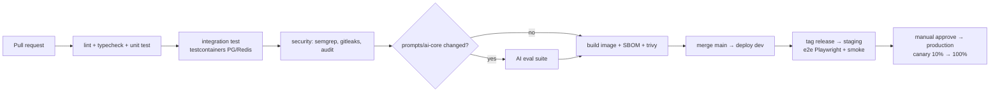

# 10 — Infrastructure, deployment & operations

## 1. Environments

| Environment | Purpose | Data | Real channels |
|---|---|---|---|
| `local` | Development on the machine (docker compose: postgres, redis, minio, mailpit, langfuse) | Seed | No — use webhook fixture replay + ngrok/cloudflared when needed |
| `dev` | Continuous integration on every merge into `main` | Seed + fake data | Internal test Page/OA |
| `staging` | Acceptance, AI eval, load testing, Meta App Review testing | Anonymized copy | Test Page/OA |
| `production` | Customers | Real | Real |

Configuration via environment variables + secret manager; the env schema is validated with Zod at startup (the app will not run if anything is missing).

## 2. Infrastructure roadmap

**Stage 1 (MVP → closed beta, < 200 workspaces):**
- 1 small cluster: 2–3 VMs or a managed container service; **managed** Postgres (with PITR), managed Redis, object storage.
- Processes: `api` ×2, `webhook` ×2, `worker` ×2 (shared queues), `scheduler` ×1 (leader lock), `web` (Next.js) ×2.
- CDN + WAF in front of web/api.

**Stage 2 (GA, broad rollout):**
- **Kubernetes** (EKS/GKE or a Vietnamese cloud's K8s), Helm charts, Argo CD (GitOps).
- HPA based on CPU + **queue length** (KEDA) for workers: separate deployments per queue (`conversation`, `outbound`, `campaign`, `indexer`, `jobs`) so that campaign bursts do not affect message replies.
- Postgres: primary + read replica (analytics/reports read from the replica), PgBouncer; Redis HA (Sentinel/Cluster).
- Multi-AZ; cross-region backups.

**Region choice:** Vietnamese SME customers → host in Vietnam (Viettel IDC / VNG / FPT / CMC) or Singapore (AWS/GCP ap-southeast-1) with ~30–40ms latency. The decision has data-law implications → see [14](14-open-decisions.md).

## 3. CI/CD

- Trunk-based, short-lived branches, PRs require review + green CI.
- DB migrations run as a separate job before rollout, **backward compatible** (expand → migrate → contract).
- Feature flags for unfinished features; release per workspace (beta testers first).
- Rollback: previous image + flag; never roll back destructive migrations.

## 4. Observability

| Signal | Tool | Mandatory content |
|---|---|---|
| Logs | Loki (JSON log, pino) | `trace_id`, `workspace_id`, `conversation_id`, never log tokens/raw PII |
| Metrics | Prometheus/Grafana | RED for the API; queue depth, job latency, retries; webhook lag; outbound success per connector; AI latency/cost per tier; ledger reconciliation |
| Traces | OpenTelemetry → Tempo | webhook → worker → LLM → outbound in a single trace |
| LLM | Langfuse | prompt, retrieved context, output, eval scores, cost |
| Errors | Sentry (FE + BE) | release tracking |
| Uptime | Synthetic check | login, end-to-end widget message sending every 5 min |
| Status page | status.<domain> | status per connector (FB/Zalo/…) |

### Minimum dashboards & alerts

- Webhook ack p99 > 1s / verification failure rate > 1%.
- `conversation` queue wait > 30s; AI error rate > 2% within 5 min.
- Outbound failure rate per connector > 5%; sudden spike in the number of channels in `error` (Meta/Zalo API change/incident).
- Ledger mismatch ≠ 0; payment IPN errors.
- AI cost/hour above threshold (abuse prevention).
- Postgres: replication lag, connection saturation, disk.

## 5. SLO (GA)

| Service | SLI | SLO |
|---|---|---|
| Webhook ingest | % of webhooks stored & acked with 2xx | 99.95% |
| AI replies | % of eligible messages answered within 15s | 99% |
| Dashboard API | % of successful requests | 99.9% |
| Message sending | % sent successfully over the valid set (excluding errors caused by the channel/customer) | 99.5% |

The error budget is used to decide priority between stability and features.

## 6. Incident handling (runbooks to be written before GA)

| Situation | Action |
|---|---|
| LLM provider down/slow | Circuit breaker → fallback provider; if all fail → send a holding message + handoff; status banner |
| Mass expiry of Meta/Zalo tokens | Mark as `error`, stop retrying, email + in-app notice to the owner, reconnection instructions |
| Queue backlog | Scale workers; prioritize the `conversation` queue; pause `campaign` |
| Duplicate/replayed webhooks | Guaranteed by idempotency; monitor the duplicate rate |
| Suspected data leak | Security incident procedure: isolate, assess, notify authorities/customers under personal data protection (BVDLCN) law within the prescribed deadline |
| DB corruption | PITR to a point before the incident; replay `inbound_events` from the log |

On-call: rotation, PagerDuty/Opsgenie; blameless postmortem for every Sev1/Sev2 incident.

## 7. Backup & DR

- Postgres: 14-day PITR + daily snapshots kept for 30 days, cross-region.
- Object storage: versioning + lifecycle.
- **Monthly restore drills** (measure real RTO/RPO), with results recorded.

## 8. Operating costs to track (unit economics)

- AI COGS / AI message per tier; infrastructure COGS / active workspace; message sending cost (ZBS/email) vs selling price; support hours / workspace / month.
- Target overall gross margin ≥ 70% after GA (subscriptions are almost pure profit, AI ≥ 60%).

## 9. Customer support & Customer Success

- Channels: in-app tickets (SLA 10 min–2h during business hours, as Preny publishes), chat (using our own product), support Zalo OA, docs.
- Neo/Enterprise plans: 1-on-1 CSM, script optimization team (chatbot trainer).
- Onboarding: short video for each module, in-app checklist, weekly webinars, industry templates.
- Internal tools: back-office quick view of a workspace, channel errors, AI logs for a single conversation (permission-controlled and audited).
