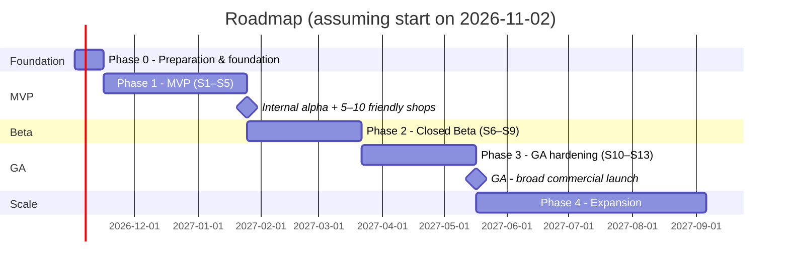

# 12 — Roadmap & implementation plan

> The estimates below assume a **team of 9–10 people** (see §1) and 2-week sprints. A smaller team → extend proportionally (a 4-person team ≈ ×1.8 the time). The figures are an initial plan to lock down scope, to be updated after Sprint 2 once real velocity is known.

## 1. Proposed team

| Role | Qty | Main responsibilities |
|---|---:|---|
| Product Owner / PM | 1 | Backlog, acceptance, shop interviews, pricing |
| Tech Lead / Architect | 1 | Architecture, reviews, ADRs, security, performance |
| Backend engineer | 3 | API, workers, channel connectors, billing, commerce |
| Frontend engineer | 2 | Dashboard, realtime inbox, widget, marketing site |
| AI engineer | 1 | ai-core, retrieval, prompts, evals, model cost |
| QA engineer | 1 | Test plan, e2e, manual AI evals, UAT with shops |
| DevOps / SRE | 0.5–1 | Infrastructure, CI/CD, observability, backups |
| Product designer | 1 | Design system, UX for inbox/CRM/orders |
| Chatbot trainer / CS | 1 (from Beta) | Industry templates, shop onboarding, real-world eval sets |
| Legal (outsourced) | — | ToS, Privacy, DPA, personal data protection (BVDLCN), invoices |

## 2. Phase overview

≈ **7 months to GA** (Phases 0–3) with the proposed team.

## 3. Phase 0 — Preparation & foundation (2 weeks)

**Non-technical work (start on day 1 because of long lead times):**
- [ ] Legal entity, domain name, brand (the product name does **not** use "Preny"), trademark registration.
- [ ] Meta: Business Manager, **Business Verification**, create the App, prepare App Review (demo video, privacy URL, data deletion URL).
- [ ] Zalo for Developers: create the app, test OA (eligible plan), register for ZNS/ZBS.
- [ ] Contracts/accounts: VNPAY merchant, bank account + balance-change webhook service, e-invoice (HĐĐT) provider, LLM providers (DPA), email sending (SES/…), carriers (test API accounts).
- [ ] Lawyer: ToS, Privacy, DPA, payment/refund policy.
- [ ] Interview 10–15 shops (ICP A/B/C) + collect a set of real questions for evals.

**Technical work:**
- [ ] Finalize ADR-001…008 ([adr/](adr/README.md)).
- [ ] Scaffold the monorepo per [11](11-code-structure-and-conventions.md), CI (lint/test/build), local docker compose.
- [ ] Minimal `dev` + `staging` infrastructure, secret manager, Sentry, logging.
- [ ] Core DB schema (identity, workspace, RLS) + seed skeleton.
- [ ] Design system v0 + wireframes: inbox, bot workspace, CRM, orders.
- [ ] Technical spikes (each spike ≤ 3 days, with a written conclusion): (1) Vietnamese retrieval + embedding selection; (2) Messenger webhook → end-to-end reply; (3) Zalo OA OAuth + refresh token; (4) BullMQ debounce + conversation lock.

**Exit:** ADRs finalized, CI green, 4 spikes with results, App Review submitted.

## 4. Phase 1 — MVP (S1–S5, 10 weeks)

Goal: **a shop can sign up on its own, create a bot from an industry template, load FAQs/products, test-chat, connect a Facebook page + Zalo OA + widget, the bot answers correctly, staff take over in the inbox, customers land in the CRM, and the shop pays for a plan/AI wallet.**

| Sprint | Backend | Frontend | AI | Other |
|---|---|---|---|---|
| S1 | Auth (ACC-01/02), workspace, members/invite, RBAC skeleton, entitlement service skeleton | App shell, auth pages, workspace/profile settings | LLM gateway, ai_runs, eval runner + first 100 cases | Seed templates for 3 industries |
| S2 | Bot, settings, instructions, knowledge (FAQ CRUD/import), indexer, basic product catalog | Bot space: home/checklist, instructions, FAQ, products, settings | Hybrid retrieval, answer pipeline, grounding guardrail, search/show_product tools | |
| S3 | Channel framework, webhook ingress, inbound_events, conversation/message, outbound queue, **website widget**, **Facebook Messenger** | Test chat (playground), integrations page, widget UI | Debounce/lock, handoff tool, fallback | Resubmit App Review if requested |
| S4 | **Zalo OA**, realtime Socket.IO, assignment, bot pause/resume, quick replies, contacts + identities, 2 default CRM rules | 3-column **Inbox**, assignment, bot on/off, quick replies, customer panel, CRM list + detail | Phone number/address extraction, red tag | |
| S5 | Billing: plans, subscription, quota counters, AI wallet + ledger, VNPAY + bank transfer, usage page; basic back-office | Upgrade, usage limits, AI wallet + history, plan purchase history, UpgradeGate | Per-tier metering, eval ≥ 300 cases | Hardening, internal alpha |

**P0 features in the MVP:** ACC-01/02/06/07/09, BOT-01→07, 09→14, CHN-01→06, 11, INB-01→02, 04→11, 13, CRM-01→04, 07→09, 14 (2 rules), ORD-01/02 (catalog, basic inventory), BIL-01→04, 07, 09, SET-01/02/04/05/07, ADM-01/02/06, WEB-01/04/06.

**Phase 1 exit (Alpha):** 5–10 real shops running for ≥ 2 weeks; 0 critical AI errors on the critical set; no lost messages (reconcile inbound_events vs messages); real payments succeed.

## 5. Phase 2 — Closed Beta (S6–S9, 8 weeks)

| Sprint | Focus |
|---|---|
| S6 | Full orders: order creation form (ORD-03), list (ORD-04), state machine (ORD-05), variants/inventory, create orders from the inbox (INB-12); order printing |
| S7 | AI-driven orders from chat (ORD-07), carriers Viettel Post + GHN + GHTK (ORD-08/09), order settings, Instagram DM (CHN-07) |
| S8 | Advanced CRM: tags with attribute fields, reminders + notifications, all 9 rules, segments, import/export, merge/split, dedupe, sync of past conversations; FB/IG comments + Posts screen (CHN-08) |
| S9 | Conversation statistics + bot performance (ANA-01/02), order overview (ORD-11), 2FA, audit log, support tickets, bot edit history, unanswered questions (BOT-18) |

**Beta exit:** 30–50 paying shops; trial→paid measurable; bot self-resolution rate ≥ the target agreed with the PO; no cross-tenant incidents; NPS / interviews after 30 days.

## 6. Phase 3 — GA hardening (S10–S13, 8 weeks)

| Sprint | Focus |
|---|---|
| S10 | ZBS wallet + ZBS campaigns (templates, audience, estimation, hold/capture), opt-in/opt-out, phone number verification |
| S11 | Workflow with 3 templates (silent follow-up chase, soft follow-up, after sales) + run log; email campaigns; Google Sheets; CAPI (ORD-12); Ads Tool (BOT-17) |
| S12 | Full affiliate, vouchers, add-ons, e-invoices; complete marketing site (industries, pricing, docs, blog), bilingual |
| S13 | **Hardening:** load test (2M messages/day, 500/s bursts), pentest + fixes, DR drill, runbooks, SLOs/alerts, K8s production, status page, support documentation |

**GA exit (go/no-go checklist):**
- [ ] All P0 + P1 features accepted.
- [ ] Pentest: no open High/Critical findings.
- [ ] Load test meets NFRs; DR drill meets RTO/RPO.
- [ ] Meta App Review grants sufficient permissions for every feature being sold; Zalo approval obtained.
- [ ] Legal: ToS/Privacy/DPA published, personal data protection dossier.
- [ ] CS team + on-call process ready; billing reconciliation shows no mismatches for 30 days.

## 7. Phase 4 — Expansion (after GA)

TikTok Business, Lazada, FMM, public API + webhooks, mobile app (React Native) for the inbox, AI copilot for staff, drag-and-drop workflow builder, sync with Pancake/Haravan/Sapo/KiotViet, multi-workspace for agencies, Enterprise (SSO, dedicated DB, SLA), appointment-booking bot (spa/dental clinic) with calendar integration, AI voice/hotline.

## 8. Project risks & mitigation

| Risk | Likelihood | Impact | Mitigation |
|---|---|---|---|
| Meta App Review/Business Verification delayed or rejected | High | Blocks the main channel | Submit from Phase 0; widget + Zalo as the first channels; use tester accounts while waiting |
| Zalo changes OA policy/pricing | Medium | Cost & features | Adapter layer; monitor Zalo announcements; communicate conditions clearly to customers |
| AI gives wrong prices/policies | Medium | Loss of credibility | Grounding + eval gate + handoff; prices from a structured catalog |
| LLM costs exceed selling price | Medium | Negative margin | Metering from day 1, tier routing, prompt caching, track COGS/message |
| Scope too broad (cloning everything) | High | GA delayed | Stick to P0/P1; everything else goes to Phase 4; PO owns the backlog |
| Cross-tenant data leakage | Low | Very severe | RLS + automated cross-tenant tests + security review |
| Direct competition (Preny and others) | High | Pricing | Differentiators: a single unified catalog, transparent answer sources, good handoff, GHN/GHTK, ROI measurement, clear pricing |
| Intellectual property risk when "cloning" | Medium | Legal | Only learn features/flows; do **not** copy Preny's code, content, images, brand, or marketing copy |

## 9. To do this week

1. Settle the open decisions in [14](14-open-decisions.md) (especially: team, cloud/data region, brand name, priority channels).
2. Start the Meta Business Verification + Zalo app procedures.
3. Schedule shop interviews, collect 200+ real questions.
4. Tech lead reviews & signs off the ADRs; scaffold the repo.
