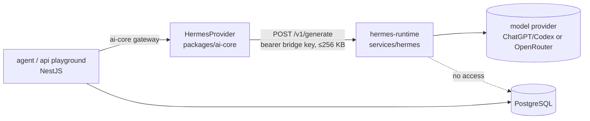

# ARCHITECTURE.md — code organization and mechanical rules

> The map every contributor (human or agent) must know. Design rationale lives in `docs/04`, decisions in `docs/adr/`; this file is the **operational** description of where code goes and which imports are allowed. Enforced by `pnpm arch` (dependency-cruiser), ESLint boundaries and `apps/backend/test/architecture.spec.ts`. If this file and the code disagree, fix one of them in the same PR.
> Basis: research of 2025–2026 practice for agent-written codebases (`docs/reference/2026-10-23-architecture-research.md`): one fixed module shape, public API per module, boundaries as lint, generators instead of improvised scaffolding, a golden module to copy.

## 1. Monorepo map

```
apps/
  backend/        NestJS 12 on Fastify — modular monolith. One codebase, several entrypoints (one image, separate deployments):
                  src/entries/api.ts · worker.ts · agent.ts · realtime.ts
  webhook/        Thin Fastify app (no NestJS): verify → persist → enqueue. Never business logic.
  web/            Vite + React 19 SPA (dashboard). features/<module> mirrors backend module names.
  admin/ site/ widget/   (later) back-office SPA · Astro marketing site · Preact chat widget
services/
  hermes/         `hermes-runtime`: private Python inference sidecar (ADR-010). Not a pnpm workspace; stdlib-tested in CI. See §7.
packages/
  shared/         Shared kernel: value objects (Money, phone), Result/error codes, ids, DomainEvent base. No I/O, no framework.
  contracts/      Zod schemas + TS types for HTTP DTOs and integration events, per module. The ONLY backend-side thing `web` imports.
  db/             Drizzle schema (one file per module), migrations (SQL), `withTenant()`, roles. Only `infrastructure/` folders import it.
  queue/          BullMQ wrappers: queue names, job contracts, tenant fairness (token buckets), idempotent job ids.
  ai-core/        LLM gateway (providers, fake provider for tests), prompt registry (`prompts/<name>@<version>.md`), tools/retrieval/guardrail interfaces, metering.
  channels/       ChannelAdapter interface + NormalizedEvent types; one adapter per platform.
  ui/             Design tokens (shadcn variable names, Rapiz palette). shadcn/ui components live in each app's src/components/ui.
  i18n/           Message catalogs (vi, en).
  testing/        Factories, tenant helpers, cross-tenant assertions. Test-only.
turbo/generators/ `pnpm gen module|use-case|feature` templates — the only sanctioned way to create a module.
docs/             Design docs, ADRs, this file.
```

## 2. Backend module shape (identical for every module)

```
apps/backend/src/modules/<name>/
  MODULE.md                 Purpose · owned tables · public API · events in/out · invariants · do-not · test command (≤ 60 lines)
  <name>.module.ts          Nest module. Exports ONLY what api/ declares.
  api/                      PUBLIC CONTRACT — the only folder other modules may import
    <name>.facade.ts        Use-case-shaped interface (not CRUD); returns DTOs from packages/contracts
    <name>.events.ts        Integration events, versioned names: "<name>.<thing>.<verb>.v1"
    index.ts                Re-exports facade token + events (the single barrel allowed in backend)
  domain/                   Pure TypeScript. Imports only packages/shared. No Nest, no Drizzle, no BullMQ, no HTTP.
    <aggregate>.ts          Rich model: invariants inside, always valid; raises domain events
    <name>.errors.ts        Typed domain errors (mapped to HTTP in interface/)
    ports/                  Repository/gateway interfaces the application layer depends on
  application/              Orchestration. Imports domain + ports + packages/contracts + packages/shared.
    commands/<verb-noun>/   <verb-noun>.command.ts · .handler.ts · .handler.spec.ts
    queries/<get-x>/        same shape; queries may read via a dedicated read port
    event-handlers/         on-<other-module-event>.handler.ts — consumes other modules' events
    jobs/                   BullMQ processors (registered by the worker/agent entry); thin, call handlers
  infrastructure/           Adapters implementing ports: persistence/ (Drizzle, via withTenant), clients/ (HTTP SDKs), messaging/
  interface/
    http/<name>.controller.ts   Thin: Zod-validate (contracts) → call handler → map Result to HTTP
  __tests__/
    factories/              Test data builders (tenant-scoped by default)
    <name>.facade.spec.ts   Contract test of the public API + event payloads
```

Layer import rules (lower may import higher, never the reverse):
`interface → application → domain`, `infrastructure → application|domain`, `api → (contracts, shared)`. **Other modules import `modules/<x>/api/**` only.** `domain` must not import `@nestjs/*`, `drizzle-orm`, `bullmq`, `fastify`, `@agent-sales/db`, `@agent-sales/queue`.

Cross-module interaction:
- **Reads**: call the other module's facade (injected by token from its `api/`). Never query another module's tables.
- **Nest wiring**: only `<name>.module.ts` may import another module's `<name>.module.ts` (in `imports: [...]`) so its exported facade can be injected; enforced by `module-wiring-only-from-module-files`.
- **Auth**: one global `AuthGuard` (identity). Routes are authenticated by default; mark exceptions `@Public()`. Routes acting on a workspace use `@WorkspaceScoped()` and read it with `@CurrentWorkspace()`; the current user comes from `@CurrentUser()` (`common/http/auth-context.ts`). Controllers never parse auth headers.
- **Writes / side effects**: publish an integration event (`api/<name>.events.ts`) through the **transactional outbox** (`outbox_events`, same transaction as the business row); consumers are `application/event-handlers` with an idempotent inbox. In-process transport now; broker later without changing handlers.
- **Analytics** reads event-fed read models, not facade chains.

HTTP contract: every route under `/api/v1` is declared in `packages/contracts/src/<module>/<module>.routes.ts` (method, path, auth, body/query, responses) and appended to `allRoutes`; the OpenAPI document (`/api/v1/openapi.json`) is built from it and `apps/backend/test/http.spec.ts` fails if served routes and declared routes differ.

Dependency injection: every constructor parameter of a Nest provider/controller uses `@Inject(TOKEN)` (a symbol or the class itself). Class-typed injection without `@Inject` works under `tsc`/Vitest but is `undefined` under `tsx` (no decorator metadata) — an architecture test enforces this.

Units of work: a module that writes more than one row (or a row + an event) exposes a `<Module>UnitOfWork` port in `application/ports/`; the Drizzle adapter runs one `withTenant` transaction and hands out repositories + the outbox publisher bound to it (see `workspace`).

Tenancy: every repository method and every query takes a `WorkspaceId`; persistence runs inside `withTenant()` from `packages/db` (transaction-scoped `set_config`, RLS backstop — ADR-004). `WorkspaceId` is a branded type from `packages/shared`.

## 3. Allowed module graph (lower rows may not import higher rows)

| Tier | Modules | Notes |
|---|---|---|
| 0 — leaf consumers | `audit`, `notification` | Only consume events; everyone may emit to them |
| 1 — platform | `identity`, `workspace`, `billing` | Entitlements/quota are a `billing` facade |
| 2 — capabilities | `bot`, `knowledge`, `channel`, `ai`, `crm`, `commerce` | `ai` depends on `knowledge`, `bot`, `commerce` (bot product grounding); `channel` on `bot`; `commerce` on `crm` |
| 3 — flows | `conversation`, `shipping`, `marketing`, `automation`, `support`, `affiliate` | Orchestrate tier 1–2 facades |
| 4 — read models | `analytics` | Consumes events only; owns rollup tables |

Golden module: **`workspace`** — copy its shape. `health` is the minimal example of an interface-only module.

## 4. Frontend shape (`apps/web/src`)

```
app/            providers, router setup, error boundaries, bootstrap (session + workspace + entitlements)
routes/         TanStack Router file routes. `_app/` = authenticated layout; `-components/` folders are colocated non-route files
features/<module>/   mirrors backend module names
  api/          TanStack Query hooks; calls lib/api-client only; types from packages/contracts
  components/ hooks/ stores/ types/
components/ hooks/ lib/ stores/ utils/   shared; may NOT import features/ or routes/
testing/        render helpers, msw handlers, factories
```

Rules: `shared → features → routes/app`; features never import each other (compose in routes); no `index.ts` barrels; one API client (`lib/api-client.ts`, raw `fetch` is lint-banned outside it); no business logic in components (hooks/stores); every user-facing string from `packages/i18n`.

Layout rules (T-017): build UI from shadcn/ui components in `components/ui` (add new ones with `pnpm --filter @agent-sales/web exec shadcn add <name>`, never hand-roll an equivalent); the dashboard shell (`components/app-shell.tsx`, shadcn `Sidebar`) owns page padding and content width, so pages set neither (full-bleed pages put `data-content-padding="false"` on their root); colours only through tokens (`packages/ui/tokens.css`, `presets.css`), never hex values in components; any layout change must keep `e2e/responsive.spec.ts` green (no horizontal overflow at 375–1920 px in every layout preference).

## 5. Mechanical enforcement (all run in `pnpm check`)

| Check | Tool | What it catches |
|---|---|---|
| `pnpm arch` | dependency-cruiser (`.dependency-cruiser.cjs`) | cycles; module public-API-only; layer direction; domain purity; apps never import other apps; web imports only `contracts/shared/ui/i18n` from packages |
| `pnpm lint` | ESLint + `eslint-plugin-boundaries` | same rules with instant, file-level feedback (remediation text in the message); `no-console`; raw `fetch` in web |
| `pnpm test` | Vitest incl. `apps/backend/test/architecture.spec.ts` | every module has `MODULE.md`, `api/`, `<name>.module.ts`; module exports ⊆ `api/` |
| `pnpm typecheck` | `tsc` strict | — |
| CI `PR checks` | workflows | conventions, task reference |

Adding a module: `pnpm gen module <name>` → fill `MODULE.md` → add its row to §3 → wire it in `app.module.ts`. Never hand-create the tree.

## 6. Entries and processes

| Entry | Boots | Queues consumed |
|---|---|---|
| `entries/api.ts` | HTTP (Fastify) + all modules' `interface/http` | — |
| `entries/worker.ts` | modules' `application/jobs` for `WORKER_QUEUES` | outbound, campaign, workflow, indexer, scheduler |
| `entries/agent.ts` | `ai` + its dependencies; the only process that calls LLMs for conversations (exception: the request/response dashboard playground and the admin connection test run in `api`) | conversation (+ priority) |
| `entries/realtime.ts` | SSE + websocket-only Socket.IO, Redis pub/sub | — |
| `services/hermes` (`hermes-runtime`) | Python HTTP bridge on a private address; no platform modules, no DB | — (called synchronously by `packages/ai-core`, see §7) |

`apps/webhook` is separate on purpose (no Nest, no business logic, p99 ≤ 500 ms).

## 7. `hermes-runtime` (ADR-010)

`services/hermes` is the only non-TypeScript runtime. It is an **optional LLM provider**, not a platform service: it turns an explicit request into model text and knows nothing about tenants, bots, conversations or channels.



| Aspect | Rule |
|---|---|
| Selection | Only through the admin-managed LLM config: provider kind `hermes` + an explicit tier route (DB, sealed by `SecretBox`). Never via `.env`, never an implicit fallback. |
| Caller | Only `HermesProvider` in `packages/ai-core` talks to it. No module, app or script calls the bridge directly. |
| Contract | `POST /v1/generate`, version `1` (request/workspace UUIDs, model, bounded messages, output budget, optional JSON schema) → `{ version, text, model, usage }`, validated with Zod on the TypeScript side. Changing it is a contract change: bump the version and keep the provider tolerant. |
| Owns | Inference only. NestJS keeps workspace authorization, retrieval, grounding, conversation state, human takeover and outbound delivery. |
| Must not | Read or write the platform database, Redis or object storage; send channel messages; run tools, shell or memory; log message content; return credentials or provider error text. |
| Network | Binds to `127.0.0.1` (or a private network address in deployment); never exposed through the load balancer. |
| Capacity | Single-flight: one active turn, `429` while busy, 50 s run budget (+ up to 15 s token refresh). `HermesProvider` therefore never times out below 70 s (`HERMES_MIN_TIMEOUT_MS`). Callers bound their concurrency. To scale, run more instances, **each with its own `HERMES_HOME` and its own login** — instances sharing one refresh token invalidate each other. |
| Credentials | One private `HERMES_HOME` (`RAPIZ_HERMES_HOME`, mode 700) and one bridge key per instance; never shared with another instance, process or project. |
| Version | The Hermes package version is not pinned yet; until T-050 lands, the bridge is dev/staging only. |
| Tests | `python3 -m unittest discover -s services/hermes -p 'test_*.py'` (CI job `hermes`) + `packages/ai-core` provider tests. No real model calls. |

Replacing Hermes with a TypeScript provider must not change any module, contract or UI: only the provider kind behind the tier route changes. Setup and limits: `services/hermes/README.md`.
