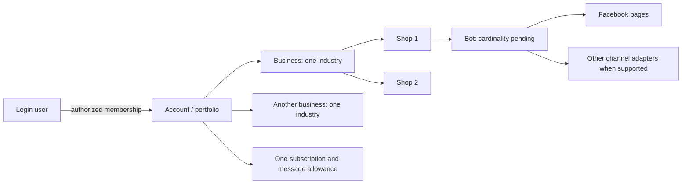

# Cofounder walkthrough: scope, estimates and two-owner delivery plan

Planning snapshot: 2026-10-26. This is a proposal from the supplied chat notes and three images, not an approved architecture decision or implementation report. No application behavior is changed by this plan.

## Product interpretation

A login user can access multiple businesses. An account is provisionally the commercial portfolio/billing owner, not necessarily identical to a personal login: membership and invited staff require explicit authorization. Each business has exactly one industry and multiple shops. Shops use bots connected to multiple external pages/channels. Account-level packages cover aggregate messages, with no commercial quantity limits on businesses, shops or bots.

Proposed mapping: retain the existing workspace as the business/RLS boundary and add a portfolio/billing owner above it plus shops below it. Validate this in T-077 rather than renaming workspace to account or weakening tenant isolation. Existing business members must not gain access to other businesses merely because their inviter pays for both.

The supplied diagram is an ownership sketch, not proof that every named channel is implemented. Do not estimate new Zalo/TikTok integrations inside assignment tasks.

## Current implementation evidence

The running app is served from `agent-sale-integration`, branch `integration/local-all`. The primary checkout is older in several relevant modules; estimates credit the running implementation rather than counting shipped work twice.

- Both checkout roots redirect `/` and `/app/` to `/app/bots`; root navigation needs a real change.
- The integration board records T-039–T-041 analytics and T-068 sales inbox as complete. Redesign these existing surfaces rather than rebuilding their backend unconditionally.
- `features/channel/components/integrations-view.tsx` and `hooks/use-integrations.ts` already share workspace/bot modes, assigning and unassigning through a common path. `lib/integrations.ts` includes unassigned filtering. The review still reports inconsistent UX: reproduce against this integrated implementation.
- The inspected database schemas have workspace industry and bot/channel relationships; there is no first-class shop schema. `features/workspace` and `lib/use-workspace.ts` are rooted in selected workspace/session context.
- Integration `packages/db/src/schema/billing.ts` defines workspace-keyed subscriptions. Moving commercial ownership above businesses is a persistence/authorization/counter migration, not only a new usage page.
- Image 1 records a failed-tag-update toast. The cause is unknown until request/response and persisted state are examined. Do not attribute it to fonts or assume a specific backend bug.
- Image 2 motivates the direct bot list switch. Image 3 motivates business/shop hierarchy and raises the unresolved catalog-sharing policy.
- Local Preny dossier: `docs/reference/preny-dashboard-spec.md`. No new authenticated audit of Preny or Pancake was performed; visual/feature parity is not claimed.

## Defaults pending product confirmation

These are assumptions for estimation, not settled requirements. Text clarification was requested in chat; dependent implementation must resolve them explicitly in T-077.

1. Each shop has one primary bot; one bot can answer several pages/channels of that shop. If bots may serve multiple shops, model that explicitly and revisit filtering, CRM attribution and estimates.
2. Businesses are workspace isolation boundaries. Contacts may have multiple bot/shop relationships through conversations; a contact is not forced to have only one bot.
3. Products are business-owned and can be offered by several shops, following the sketch. Separate inventory/pricing per shop is not specified; a new stock engine is excluded.
4. Provisional billing unit: an AI reply successfully sent, counted once despite retries. Generation failure, delivery failure, human messages, inbound messages and test chat are provisionally excluded. Confirm definition, period/timezone, reset, quota exhaustion, upgrade and overage behavior before coding counters.
5. `/` after authentication and clicking the logo open the all-business portfolio statistics screen. Login presents business selection; selecting a business opens its statistics. Resolve this apparent entry-flow overlap explicitly through T-077 route examples; anonymous root/auth behavior stays deliberate.
6. The outer platform integration inventory initially covers the selected business, across all its shops and bots. If it should span the entire account, expand its authorization and UX scope deliberately. All-business statistics remain an explicit account-scoped view.
7. Tag and customer-status definitions live in Customer settings, provisionally business-scoped. Customer status, conversation open/resolved, channel connectivity, channel bot assignment and bot enabled state are independent concepts.
8. Business settings are capability-aware settings for its industry. This is not authorization to build complete hotel/education operations.
9. “CRM identical” and “like Pancake” mean agreed improvements to current workflows and scoped relationships. Complete product parity requires a screen/behavior inventory and a new estimate.
10. Advanced bot settings means organizing and exposing existing working settings, with a reviewed field list. Additional automation/LLM controls require separate sizing.
11. Existing payment methods are reused. New gateways, payment reconciliation, invoices, wallets and vouchers are not included in the base plan. Account plan/usage UI must represent actual backend capabilities honestly.
12. Shared business access and the account paying for a business must be modeled separately. Transfer of a business between payers and treatment of existing multiple paid subscriptions require a migration rule, not an automatic guess.

## Task breakdown and equal allocation

Initial proposal: A for the user and B for the cofounder. Assignment update on 2026-10-26: the user assigned A to the cofounder and B to the user with Codex. Effort totals are unchanged. No cofounder GitHub handle has been guessed. See the lane B QA handoff for delivered work and remaining dependencies.

One person-day is approximately six focused engineering hours, including implementation, self-review and task-specific regression checks. These are engineering estimates, not a quote or a promise of elapsed delivery time. Base total: **56 person-days: A 28, B 28**. Allow approximately -30%/+40% (about 39–79 person-days), with the greatest uncertainty in ownership migration and metering. No blanket AI speed multiplier is applied. Shared task T-094 is counted once at four days, two per person.

| Task | Deliverable | Lane | Base person-days | Dependencies |
|---|---|---|---:|---|
| [T-077](../../todo/T-077-define-account-business-shop-ownership-and-migrati.md) | Define account business shop ownership and migration contracts | A | 2 | None |
| [T-078](../../todo/T-078-add-account-business-and-shop-persistence-with-saf.md) | Add account business and shop persistence with safe backfills | A | 6 | T-077 |
| [T-079](../../todo/T-079-add-business-selection-and-switching-across-sessio.md) | Add business selection and switching across sessions | A | 3 | T-077, T-078 |
| [T-080](../../todo/T-080-manage-shops-and-their-catalog-and-bot-association.md) | Manage shops and their catalog and bot associations | A | 3 | T-077, T-078 |
| [T-081](../../todo/T-081-redesign-portfolio-and-business-statistics-entry-s.md) | Redesign portfolio and business statistics entry screens | B | 4 | T-077, T-078, T-079 |
| [T-082](../../todo/T-082-unify-channel-assignment-and-bulk-bot-filters.md) | Unify channel assignment and bulk bot filters | B | 3 | T-077, T-078, T-080 |
| [T-083](../../todo/done/T-083-move-fanpage-management-into-the-bot-workspace-nav.md) | Move fanpage management into the bot workspace navigation | B | 2 | T-077, T-082 |
| [T-084](../../todo/done/T-084-expose-bot-switches-and-advanced-settings-consiste.md) | Expose bot switches and advanced settings consistently | B | 2 | T-077, T-078 |
| [T-085](../../todo/done/T-085-separate-bot-training-facts-from-behavioral-instru.md) | Separate bot training facts from behavioral instructions | B | 2 | T-077 |
| [T-086](../../todo/done/T-086-refine-the-sales-inbox-around-the-agreed-pancake-w.md) | Refine the sales inbox around the agreed Pancake workflow | B | 4 | T-077 |
| [T-087](../../todo/T-087-filter-the-multichannel-inbox-by-shop-bot-and-chan.md) | Filter the multichannel inbox by shop bot and channel scope | B | 3 | T-078, T-080, T-082 |
| [T-088](../../todo/T-088-link-crm-customers-to-business-shop-bot-and-conver.md) | Link CRM customers to business shop bot and conversations | A | 4 | T-077, T-078, T-080 |
| [T-089](../../todo/T-089-centralize-customer-tags-and-statuses-in-customer-.md) | Centralize customer tags and statuses in customer settings | A | 2 | T-077, T-078 |
| [T-090](../../todo/done/T-090-diagnose-and-fix-failed-inbox-tag-updates.md) | Diagnose and fix failed inbox tag updates | B | 1 | None |
| [T-091](../../todo/T-091-move-subscription-and-message-quota-ownership-to-t.md) | Move subscription and message quota ownership to the account | A | 6 | T-077, T-078 |
| [T-092](../../todo/T-092-add-account-level-plans-and-aggregated-usage-setti.md) | Add account-level plans and aggregated usage settings | B | 3 | T-079, T-091 |
| [T-093](../../todo/T-093-scope-business-settings-and-bot-defaults-to-the-se.md) | Scope business settings and bot defaults to the selected industry | B | 2 | T-077, T-078, T-079 |
| [T-094](../../todo/T-094-validate-the-cross-business-review-milestone-end-t.md) | Validate the cross-business review milestone end to end | Shared | 4 | Both lanes complete |

The task files contain scope, exclusions and verifiable acceptance criteria. Scope already completed in analytics/inbox/billing receives reuse credit; task-level estimates should be revised if the integration implementation cannot be retained.

## Execution order and conflict boundaries

1. **Joint contract kickoff:** A owns T-077 (two person-days), B reviews it and prepares annotated target screens and frontend mocks. Agree DTOs, route map, cardinalities, historical attribution, scope and billing semantics before changes spread.
2. **Foundation:** A implements T-078. In parallel B can reproduce/fix T-090 and work on T-085 and design T-086/T-081 using stable mocks. B can build UI scaffolds, but schema-dependent acceptance waits for actual foundation APIs.
3. **Parallel delivery:** A completes T-079/T-080, then T-088/T-089/T-091. B completes T-082/T-083/T-084/T-086/T-087, followed by T-081/T-093; T-092 integrates only after quota APIs are available. UI shells can start earlier against agreed fixtures.
4. **Joint acceptance:** T-094 assigns two days to each owner for integration, isolation and counter reconciliation, followed by reviewed deployment sequencing.

A owns workspace/identity/membership contracts, shop persistence, CRM relationships/customer definitions and quota backend. B owns app navigation/screens, channel assignment UX, inbox surfaces, bot controls and account usage UI. Account selector and shared route/layout files must have one writer at a time: A lands selection/context contracts before B integrates portfolio/navigation. Shared `packages/contracts`, migrations, i18n resources and `TODO.md` need small sequential commits; owners coordinate rather than editing the same file concurrently.

T-090 may touch CRM tag contracts. B owns the localized defect and its failing regression; A owns the later canonical definitions in T-089. Preserve the defect regression when merging. Avoid implementing tag migration twice.

Suggested coherent PR blocks: A foundation (T-077–T-080), B inbox/bot/integrations (T-082–T-087 plus T-090), A CRM/quota (T-088/T-089/T-091), B overview/settings (T-081/T-092/T-093), then shared acceptance T-094. Keep task-level commits. These are dependency blocks, not one giant parallel migration. Pair-review the architecture and financial counter changes.

## Effort versus calendar

At full availability and equal throughput, 28 focused person-days each implies a theoretical 5.6 five-day workweeks. Foundation dependencies, reviewer availability and integration reduce parallelism; plan around **7–9 calendar weeks** for the base scope with two dedicated contributors, then revise after T-077. Part-time availability extends this proportionally. The range is not a deadline commitment.

Do not balance by number of tasks: A has fewer but riskier migration/metering tasks; B has more UI/interaction tasks and integration edges. Both share final acceptance. Rebalance remaining effort after the ownership ADR and first vertical slice, not by moving random small tickets.

## Acceptance dataset and release gates

Use at least two unrelated accounts, a shared business member, two industries, several shops, one provider on multiple pages, assigned/unassigned/disconnected channels and a returning customer across pages. Include a nearly exhausted package and retrying outbound event. Verify all-business totals and business detail, two switch entry points, scope/cache isolation, page assignment from both screens, direct bot toggles, shared customer definitions, tag persistence, CRM navigation and quota reconciliation.

Every implementation task requires appropriate regressions, updated docs/i18n and `pnpm check`; RLS and authorization changes require cross-tenant checks. Record existing infrastructure failures separately. The integration tree has a known initial bundle budget follow-up T-076: do not weaken that gate or count its repair inside this review estimate. Planning-only checks validate task links, allocation sums and formatting; they do not establish that reported runtime bugs are fixed.

## Existing backlog coordination

- T-039/T-040/T-041: shipped on the running integration tree; reuse analytics definitions/projections rather than duplicate.
- T-068: shipped sales inbox; T-086 is a targeted follow-up to the reviewed workflow.
- T-070: coordinate training/instruction work; T-085 owns information architecture and explanatory content, not a duplicate rules engine.
- T-074: bot list delete/settings work; reuse it when adding the switch and preserve existing behavior.
- T-034–T-038 and T-042: CRM reminders, custom fields, imports, files, historical automation and broader acceptance remain distinct unless explicitly pulled into scope.
- T-049: channel dead letters/disconnect cleanup is not a hidden part of assignment UX.
- T-059/T-060: invoices, payment history, wallets and vouchers are excluded from this plan.
- T-076: existing integration bundle gate blocker remains separate.

## Lane A replan (2026-10-28)

Lane A is now owned by @agent:claude; nobody had started it. The cofounder (Tùng) works on the inbox (T-095/T-096 and follow-ups), which is lane B territory, so T-086 is superseded there.

**Product decisions (user, 2026-10-28).** These replace defaults 1–4 above:

- Model: account → business (workspace) → bot → channels. **There is no shop entity.** The bot is the selling unit.
  - One account owns several businesses, switched from the avatar menu like the workspace switcher of common SaaS apps.
  - A business can create many bots.
- Catalog: products are business-owned. Each bot sells either the whole catalog or a chosen subset; prices and stock are shared.
- Billable unit: an AI reply successfully delivered to the customer, counted once across retries. Human, inbound and test messages are not billed.
- Exhausted allowance: the bot stops, the conversation is handed to staff, the customer gets a "staff will reply soon" message and the dashboard shows a banner (docs/08).

**What exists today** (code inventory, 2026-10-28):

- There is no account, shop or organization concept anywhere. The workspace is the business, the RLS boundary and the billing unit; `subscriptions` is keyed by `workspace_id`.
- Only the seat limit is enforced. Messages are not metered; `ai_runs` writes one row per LLM turn, so it over-counts retries.
- T-081 already delivered the sidebar business selector, per-request tenant capture and cache isolation on switch.
- Conversations and analytics facts carry the channel, not the bot, so reassigning a page moves its history to the new bot. Meta conversations have no stored contact link.
- CRM and inbox already share tag definitions. Customer status and conversation status are separate.

**Re-estimate.**

| Task | Was | Now | Why |
|---|---:|---:|---|
| T-077 | 2 | 2 | — |
| T-078 | 6 | 4 | no shop entity |
| T-079 | 3 | 2 | T-081 delivered the selector and isolation |
| T-080 | 3 | 2.5 | bot catalog selection; absorbs lane B's T-110 |
| T-088 | 4 | 4–5 | Meta contact link missing |
| T-089 | 2 | 1 | core already shared |
| T-091 | 6 | 7–9 | no metering exists |

Lane A total: about 22.5–25.5 person-days (was 28). Blocks:

- A1: T-077 + T-078
- A2: T-079 + T-080
- A3: T-089, T-088, T-091

Lane B tasks that mention shop scope (T-082, T-087) now mean bot scope.

## Planning artifact locations

New IDs T-077–T-094 were allocated through `pnpm todo:new` on the running integration tree to avoid colliding with its existing T-071–T-076. The new task files and board entries were mirrored into the primary checkout; existing task IDs, entries and files were preserved, even where historical checkouts use different meanings for older IDs. The handoff is mirrored in both trees. Reconcile via the chosen integration base before future implementation; do not merge stale historical board state wholesale.
