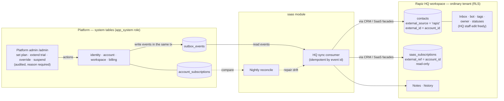

# Rapiz HQ and the SaaS vertical — design rules

> Status: **decided** (2026-11-02, decisions in §9). The rules in §3 are ADR-021; §7 is the delivery plan.
> Builds on ADR-012 (accounts), ADR-017 (external source of truth), ADR-020 (SaaS vertical).

## 1. Problem

Rapiz is itself a SaaS company. It needs to sell to, onboard, support, bill and retain its own customers
(the businesses that sign up). We want to do that **inside Rapiz** (dogfooding the SaaS vertical), but
the facts about those customers — who signed up, which plan, trial dates, usage — live in **platform
tables** (`users`, `accounts`, `workspaces`, `account_subscriptions`, `message_usage`), not in any
tenant's CRM.

Three questions:

1. How does the "Rapiz business" get that data without breaking tenant isolation?
2. Whose API/interface do we use — KiotViet's, Odoo's, our own?
3. Does the SaaS vertical (PR #93) cover what a real operator of Rapiz needs day to day?

## 2. Decision in one paragraph

**Rapiz HQ is an ordinary `saas` workspace.** It receives a **one-way, event-driven sync** of
account-level facts from the platform (signup, plan, status, dates, usage), written through the same
CRM and SaaS facades any tenant uses. The platform stays the source of truth for billing facts; HQ owns
the sales and support work (status before signup, notes, tags, owner, conversations). Operator
**actions** (change plan, extend trial, suspend) happen in the **platform admin**, never in the HQ CRM.
The sync speaks **Rapiz's own versioned event contract** (`packages/contracts`), which later becomes the
public webhook contract (VRT-10). No third-party schema (KiotViet, Odoo) is used for this.

## 3. Design rules

### R1 — HQ is a normal tenant
- No code path reads another tenant's data "because it is HQ". HQ runs under RLS like every workspace.
- HQ is identified by configuration (`RAPIZ_HQ_WORKSPACE_ID`), created once by an operator CLI
  (`hq-init`), industry `saas`. Unset → the sync is off (dev, tests, self-hosted).
- HQ staff are ordinary members with ordinary roles. Being a platform admin grants nothing in HQ, and
  being an HQ member grants nothing in `/admin`.

### R2 — Who owns which fact (ADR-017 applied)
| Fact | Source of truth | In HQ |
|---|---|---|
| Owner name, email, phone (at signup) | `identity` / `account` | Synced into the linked contact on create; later edits in HQ allowed for name only (decision D4) |
| Account id, businesses (name, industry, created) | `account` / `workspace` | Synced, read-only |
| Plan, period, status, period start/end, trial end | `billing` (`account_subscriptions`) | Synced into `saas_subscriptions`, **read-only** (409 `EXTERNAL_SOURCE`) |
| MRR | Derived from plan `price_by_period` × period | Computed by the sync, read-only |
| Usage (AI messages used / included, members, channels) | `billing` | Synced snapshot, read-only |
| Pipeline status before signup, notes, tags, owner, follow-ups, conversations | HQ CRM | Fully editable |
| Status after signup (`trial`/`paying`/`past_due`/`churned`) | Driven by the synced stage | Not hand-editable for linked contacts |

### R3 — One direction only: platform → HQ
- HQ never writes back to billing or identity. To change a plan, an operator uses `/admin`; the change
  emits an event; HQ follows.
- An HQ contact that never signed up (a bot lead) stays fully Rapiz-HQ-owned until it is linked.

### R4 — Events are Rapiz's own contract
- New integration events, Zod schemas in `packages/contracts`, written to `outbox_events` in the same
  transaction as the change (ARCHITECTURE §2):
  - `account.account.created.v1` (accountId, owner userId, name, email, phone, occurredAt)
  - `account.account.status_changed.v1` (active/suspended)
  - `workspace.workspace.created.v1` (exists) and `workspace.workspace.status_changed.v1`
  - `billing.subscription.changed.v1` (accountId, plan code/version, periodMonths, status,
    periodStart/End, trialEndsAt, reason: `signup|admin|payment|expiry|cancel`)
  - `billing.usage.snapshot.v1` (accountId, cycle, aiMessagesUsed/included, members, channels) — daily
- Payloads carry **account-level metadata only**: never a tenant's contacts, conversations or products.
- Names, envelope and versioning follow the existing `<module>.<aggregate>.<event>.vN` scheme so the
  same events can later be delivered as public webhooks (R10) without a second schema.

### R5 — Identity mapping
- **One HQ contact per account** (the paying customer), not per user and not per workspace.
  `contacts.external_source = 'rapiz'`, `external_id = <account_id>` (unique index exists, migration 0051;
  the `ContactExternalSource` enum gains `'rapiz'`).
- On `account.account.created`, adopt an existing **unlinked** HQ contact matched by phone, then email
  (the bot lead who asked for a demo), like KiotViet adopts by phone; else create one.
- Businesses of the account are shown as facts on the contact (list from the sync), not as contacts.
- Other people of the account (billing members, staff) are not contacts in phase 1 (decision D3).

### R6 — Subscription mirror
- HQ's `saas_subscriptions` row for a linked contact has `external_ref = <account_id>` and is written
  only by the sync. Stage mapping: `trialing→trial`, `active→active`, `past_due→past_due`,
  `suspended|canceled→canceled`. Plan name = plan display name; MRR = monthly price for the period.
- The existing stage→status move (`STAGE_STATUS`) keeps the CRM status in step.

### R7 — Reliable, idempotent, self-healing
- The consumer is idempotent by outbox event id (store the last applied event per account, or an
  applied-events table) and order-tolerant (apply only if the event's `occurredAt` is newer).
- A nightly **reconcile** compares `account_subscriptions` + accounts with HQ and repairs drift, logging
  counts, never PII (same idea as the KiotViet reconcile).
- A backfill CLI (`hq-backfill [--dry-run]`) links all existing accounts once.

### R8 — Admin acts, HQ observes
- Operator actions live in `/admin` behind `@PlatformAdmin()`, each with a mandatory reason and an
  audit entry: set plan/period, start/extend trial, entitlement override, suspend/reactivate, record a
  manual payment.
- HQ shows an "Open in admin" link on linked contacts for users who are also platform admins.

### R9 — Privacy and support access
- HQ sees account metadata and aggregates only. Looking inside a customer's workspace for support is
  **impersonation / support access** (ADM-05): consent or time-boxed grant, full audit, read-only by
  default. It needs its own ADR before any code.
- Synced personal data (owner email/phone) is the customer's own contact data for a B2B relationship;
  account deletion must also anonymise the HQ contact (event `account.account.deleted.v1`, later).

### R10 — Integrations with third-party CRMs/ERPs (the "whose API" question)
There are two different directions; they need different answers.

| Direction | Example | Whose interface | Status |
|---|---|---|---|
| **Rapiz calls their system** (connector) | KiotViet, Sapo, Haravan, Pancake POS, Odoo | **Theirs**, one provider adapter each inside `integration` | KiotViet done; adapter is KiotViet-specific today |
| **Their system calls Rapiz** (public API + webhooks) | A tenant's Odoo/HubSpot/own ERP, n8n/Make/Zapier | **Ours**: Rapiz REST `/api/v1` + signed webhooks | Not built (VRT-10, P2) |
| **Rapiz platform → Rapiz HQ** | This document | **Ours**, internal events (R4) | To build |

Rules:
- **Never adopt a vendor schema (KiotViet, Odoo) as Rapiz's public contract.** KiotViet's API is a
  retail POS API; Odoo's external API is a generic model RPC (XML-RPC/JSON-RPC) whose shape depends on
  each installation's modules. Both are good *targets* for connectors, bad *contracts* for us.
- The public API is generated from the Zod contracts we already have (OpenAPI), covers the tenant's
  own resources (contacts, orders, conversations, products, bookings, saas subscriptions), uses
  workspace-scoped API keys with capabilities equal to a role, `Idempotency-Key` on writes, cursor
  pagination, and changes only additively (rule 05).
- Webhooks reuse the R4 event names and envelope, HMAC-SHA256 signature with timestamp, retries with
  backoff, a delivery log — the same shape the HQ sync consumes internally.
- Before a second connector (Sapo/Haravan/Odoo), extract a `PmsProvider` port from the KiotViet
  gateway (today `KIOTVIET_GATEWAY` with `Kv*` types and a `provider in ('kiotviet')` check).
- Odoo is a connector candidate for larger SMEs, after Sapo/Haravan (Vietnamese retail first). For CRMs
  without a connector, the public API + webhooks + n8n/Make is the answer, not a bespoke adapter each.

## 4. What exists today (facts, 2026-11-02 `main`)

**SaaS vertical (PR #93, ADR-020)**
- `saas_subscriptions`: one row per contact; free-text `plan_name`; stage `trial|active|past_due|canceled`;
  period `monthly|quarterly|yearly`; hand-typed `mrr` (VND only); seats; trial/start/renew/cancel dates;
  free-text `external_ref`; versioned; audited.
- API: list (filter by stage, `endingSoon` = trials ending in 7 days), summary (MRR, counts), get/put per
  contact. No delete, no history, no events.
- CRM statuses for `saas`: `new_lead → contacted → requested → trial → paying → past_due → churned`.
- Bot tool `record_saas_request` (demo | trial | consultation): find/create contact by phone, move to
  `requested` (forward only), add a note. No demo slot, no trial provisioning, no conversation link.
- Web: MRR/stage strip and plan/MRR/next-date columns on `/app/contacts`, subscription card on the
  customer sheet and inbox panel, a free-entry form. No SaaS-specific pages.

**Platform billing (what HQ would mirror)**
- `accounts` + `account_members` (owner | billing); no HTTP, no events. `accounts.status` unused.
- Plans `free`, `sales_smart`, `sales_pro`, `sales_neo` with `price_by_period` (3/6/12 months) and
  entitlements. `account_subscriptions` holds the effective plan.
- Signup creates user → account → workspace. **No subscription and no trial** (free = no row).
- Plans change only by CLI `workspace-plan set`. No payments, invoices, wallet, ledger.
- Status and period end are **not enforced**; only `members.max` and AI messages are.
- `message_usage` meters AI replies (reserve/capture/release) per account cycle.
- Outbox: only `workspace.workspace.created.v1` exists on the platform side; nobody consumes it.
  Account/billing/identity emit nothing.

**Platform admin**: only `/admin/llm`. Everything else is CLI (`platform-admin`, `workspace-plan`,
`account-backfill`, `mfa-reset`, …).

**Channels for selling Rapiz**: Facebook, Instagram, website widget. Zalo is "coming soon".

## 5. Operator use cases (playing Rapiz's operations team)

Legend: ✅ works today · 🟡 partly / manual · ❌ missing. "Where" = HQ (CRM work) or Admin (platform action).

### 5.1 Acquire
| # | Use case | Where | Today |
|---|---|---|---|
| A1 | Visitor chats on Rapiz fanpage/site, bot answers about plans and features | HQ | ✅ saas pack, profile fields |
| A2 | Bot records a demo / trial / consultation request with name + phone | HQ | ✅ `record_saas_request` |
| A3 | Sales books a demo slot and gets reminded | HQ | ❌ no calendar/appointment for saas; note only |
| A4 | Leads from Zalo (main B2B channel in VN) | HQ | ❌ Zalo coming soon |
| A5 | Auto-assign new leads to a sales person by source | HQ | ✅ distribution rules |
| A6 | See lead → demo → trial → paid funnel | HQ | 🟡 statuses exist; no funnel report by stage dates |

### 5.2 Sign up and trial
| # | Use case | Where | Today |
|---|---|---|---|
| T1 | A signup appears in HQ automatically, linked to the earlier lead | HQ | ❌ no sync (R4–R5) |
| T2 | A new account gets a real trial (paid-plan features, end date) | Admin/billing | ❌ signup = free, no trial row |
| T3 | Operator extends a trial for a promising customer | Admin | ❌ CLI only, no trial concept |
| T4 | List trials ending in 7 days, with owner and usage | HQ | 🟡 `endingSoon` exists but HQ has no real trial data |
| T5 | Automatic reminder to customer and to sales before trial end | HQ/billing | ❌ |
| T6 | Activation tracking: bot created, channel connected, first AI reply, KiotViet connected | HQ | ❌ no events for these milestones |

### 5.3 Convert and bill
| # | Use case | Where | Today |
|---|---|---|---|
| B1 | Customer picks a plan/period and pays (VietQR transfer, VNPAY) | Billing | ❌ no payments |
| B2 | Operator confirms a bank transfer and activates the plan | Admin | ❌ CLI `workspace-plan set` only |
| B3 | Upgrade mid-period (prorated), downgrade next period | Billing/Admin | ❌ no proration, no scheduling |
| B4 | Extra seats / entitlement override with reason and expiry | Admin | 🟡 tables exist, no UI/API |
| B5 | Invoice / VAT e-invoice | Billing | ❌ |
| B6 | Voucher / discount for a deal | Billing | ❌ (P3) |
| B7 | HQ sees plan, MRR, next renewal without typing them | HQ | ❌ typed by hand today |

### 5.4 Renew, collect, churn
| # | Use case | Where | Today |
|---|---|---|---|
| R1 | Renewal reminder before period end | Billing/HQ | ❌ |
| R2 | Past due → grace → suspended → free (bot stops, data read-only) | Billing | ❌ status not enforced |
| R3 | Customer cancels; record churn reason | HQ/Admin | 🟡 `canceled` stage; no reason field |
| R4 | Win-back list of churned accounts | HQ | 🟡 status filter; no reason/segment |
| R5 | Reactivate a suspended account | Admin | ❌ |

### 5.5 Support and success
| # | Use case | Where | Today |
|---|---|---|---|
| S1 | Customer writes to Rapiz support; agent sees who they are, plan, usage | HQ | 🟡 inbox works; plan/usage not synced |
| S2 | Agent checks a customer's channel/bot health (page disconnected, AI quota out, KiotViet errors) | HQ/Admin | ❌ |
| S3 | Agent looks inside the customer's workspace to debug (with consent) | Admin | ❌ needs ADR (R9) |
| S4 | Upsell trigger: AI messages ≥ 80% | HQ | ❌ banner for tenant only; HQ not told |
| S5 | Account with several businesses / several people | HQ | 🟡 one contact = one person; no company entity |
| S6 | Announce a feature or maintenance to all customers | HQ | ❌ no broadcasts |

### 5.6 Platform operations
| # | Use case | Where | Today |
|---|---|---|---|
| P1 | Search accounts/workspaces/users, see plan, usage, channels | Admin | ❌ (ADM-01) |
| P2 | Platform KPIs: MRR, signups, trial→paid, churn, AI cost | Admin | ❌ (ADM-07); HQ MRR is manual |
| P3 | LLM providers and tier routing | Admin | ✅ `/admin/llm` |
| P4 | Grant/revoke platform admin | CLI | ✅ by design (no API) |
| P5 | Plan catalog and prices editable | Admin | ❌ seeded by migration |
| P6 | Feature flags per workspace | Admin | ❌ (ADM-08) |

**Verdict:** the SaaS vertical covers the *pre-signup* half well (bot capture, statuses, assignment,
inbox). Everything after signup is either manual or missing, mainly because the platform side
(trial, payments, lifecycle, events, admin actions) does not exist yet. HQ cannot be better than the
billing facts behind it, so most work is on the platform side, not in the CRM.

## 6. Gaps in the SaaS vertical itself (benefit every SaaS tenant, not only HQ)

1. Plan catalog per workspace (name, period prices) so MRR is computed, not typed.
2. Subscription history (plan/stage changes over time) instead of one overwritten row; needed for
   churn and expansion MRR.
3. Churn reason (enum + note) on cancel.
4. A `demo_scheduled` status or an appointment object (shared with the services vertical, VRT P1).
5. Reminders: trial ending, renewal due — as follow-up tasks for the owner.
6. Linked rows (`external_ref` set by a sync) must be read-only in the form (R2), like KiotViet fields.
7. Multiple contacts per customer company (company entity or "contact belongs to account").

## 7. Phased plan

**Phase 0 — prerequisites on the platform (owner: SaaS + admin lane)**
- Emit account/billing events (R4) from `account`, `billing`, `identity`; add `workspace` status event.
- Plan catalog editor and trial settings in `/admin` (D1): plans are versioned, an edit adds a version.
- Real trial on signup (decision D1) and an admin API to set plan / extend trial with reason + audit
  (replaces the CLI as the primary path; CLI stays).
- Admin read-only lists: accounts, workspaces, users, plan, usage (P1).

**Phase 1 — HQ sync MVP**
- `hq-init` CLI, `RAPIZ_HQ_WORKSPACE_ID`, `ContactExternalSource += 'rapiz'`.
- Consumer in `saas` (`application/event-handlers/`), writing through CRM and SaaS facades; adoption by
  phone/email; read-only linked fields; MRR from plan price.
- `hq-backfill` + nightly reconcile; sync log by code, no PII.
- Usage snapshot daily → contact facts; upsell flag at 80%.

**Phase 2 — lifecycle and money**
- Enforce status (past_due → suspended → free), renewal and trial reminders.
- VietQR bank transfer with manual confirm in admin, then automatic matching; VNPAY.
- Invoices; subscription history; churn reason; plan catalog for SaaS tenants (§6).

**Phase 3 — openness**
- Public API + webhooks (VRT-10) on the R4 contract; API keys; OpenAPI.
- `PmsProvider` port, then Sapo/Haravan, later Odoo connector.
- Support access / impersonation (own ADR), broadcasts, activation milestones from more events.

## 8. Non-goals (for now)
- HQ editing billing facts; two-way sync.
- Syncing any tenant's customer data into HQ.
- A separate `apps/admin` deployment (keep `/admin` in the dashboard until the back-office grows).
- Building our own general CRM/ERP API compatibility layer (Odoo/HubSpot shaped).

## 9. Decisions (owner, 2026-11-02)

| #   | Question | Decision |
| --- | -------- | -------- |
| D1  | Trial on signup | **Configured by platform admins**, not hard-coded. A trial settings screen in `/admin` picks the trial plan (an entry plan), length in days, on/off, and the plan after the trial (default `free`). No card or payment is asked. The same release adds a **plan catalog editor** in `/admin` (name, prices per period, entitlements, public/hidden); an edit creates a new plan version so existing subscribers keep theirs. |
| D2  | HQ identity | Env var `RAPIZ_HQ_WORKSPACE_ID` + `hq-init` CLI; no schema flag. |
| D3  | Who becomes an HQ contact | Account owner only in phase 1; company entity later. **Configurable**: an HQ sync setting in `/admin` (`owner` now; `owner_and_billing` once more than one person per account is supported). |
| D4  | Editing synced name/phone in HQ | Name yes; phone and email no (they are the link keys). |
| D5  | Where the consumer lives | `saas` (internal, no external credentials); `integration` stays for third-party systems. |
| D6  | HQ workspace on production | A new workspace "Rapiz"; the maintainer is owner, Tùng invited. Not TinyMind. |
| D7  | First payment method | VietQR bank transfer confirmed by hand in `/admin`; automatic matching, VNPAY and others later. |

Effect on §7: the plan catalog editor and trial settings move into the first platform-admin PR (phase 0).
